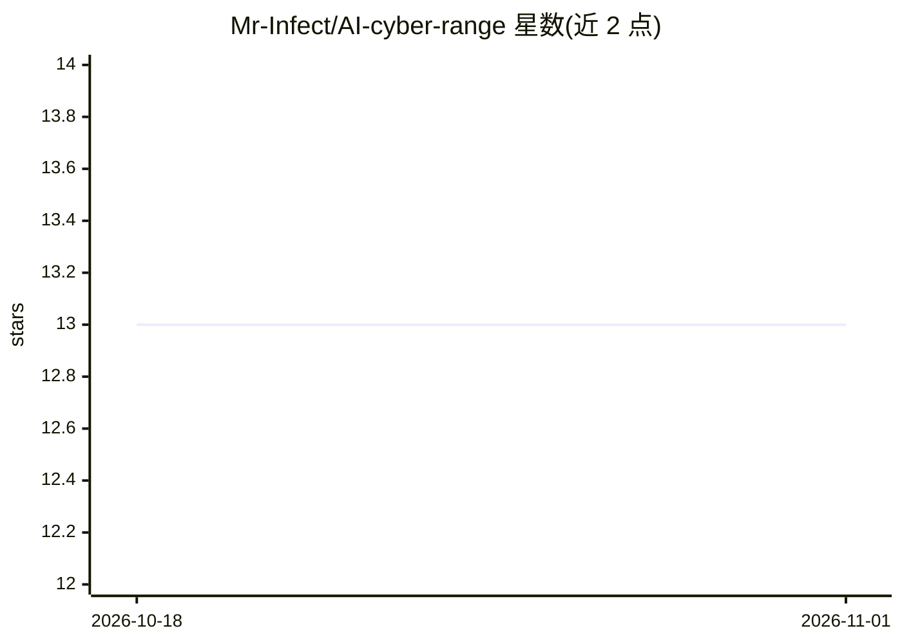

# Mr-Infect/AI-cyber-range

⭐ 13 · Python · 推送 2025-11-30 · [GitHub](https://github.com/Mr-Infect/AI-cyber-range) · 个人维护

**OWASP LLM Top 10 攻防靶场：Docker 化模拟 LLM 漏洞供练习**

面向 AI 安全研究、红队与教学的渗透测试实验室：覆盖 OWASP Top 10 for LLMs 全部十类漏洞（提示注入、不安全输出处理、模型盗取等），每类含多个场景与难度分级，通过 labctl.py CLI 启动，为所选漏洞拉起隔离的 Docker 化易受攻击 LLM 端点，本地浏览器访问，攻破后提取随机 SHA-256 flag，实验室自动重置。100% 离线自包含，一键脚本自动安装依赖，技术栈为 Python FastAPI + Docker Compose + YAML 配置。要求 Ubuntu/Debian/WSL2、Python 3.10+、Docker。

## 筛选速览

| 维度 | 判定 | 备注 |
|---|---|---|
| AI 角色 | `ai-ecosystem` | LLM/agent 周边工具 |
| 许可风险 | `none` | — |
| 部署形态 | `self-host` | docker 或自建部署 |
| 模型依赖 | — | README 未给出锁定关系 |
| 硬件要求 | — | 无带数字的原话,不猜 |
| 安装摩擦 | `low` | 无编译、无系统依赖或容器化 |
| 成熟度 | — | 结构信号不足 |

## 能力要点

- 覆盖 OWASP LLM Top 10 全部十类漏洞，含多场景与难度分级
- 每个漏洞独立 Docker 隔离，会话内随机 SHA-256 flag，完成后自动重置
- 一键 setup.sh 自动安装 Python、Docker 等全部依赖
- 100% 离线自包含，本地浏览器访问每个易受攻击端点

## 适用场景

- 红队与渗透测试人员练习 LLM 攻击技术
- 安全课堂上互动演示 LLM 风险
- AI 产品团队验证自身产品的安全防护
- SOC 分析师了解 AI 威胁的攻击路径

## 场景标签

`网络安全` · 领域:学习与行业

## 证据(README 行号)

> L14: * AI Security researchers to **experiment with adversarial AI attacks**
> L17: * Engineers to **validate AI product security**

## 星数曲线

2026-10-18 13 → 2026-11-01 13（+0）

---
*卡片 v1 · prompt 1.4 · 生成 2026-10-31 · 置信度 mid · 依据 README sha `103e064f8ff6` · [字段定义](../../DATASET.md)*
