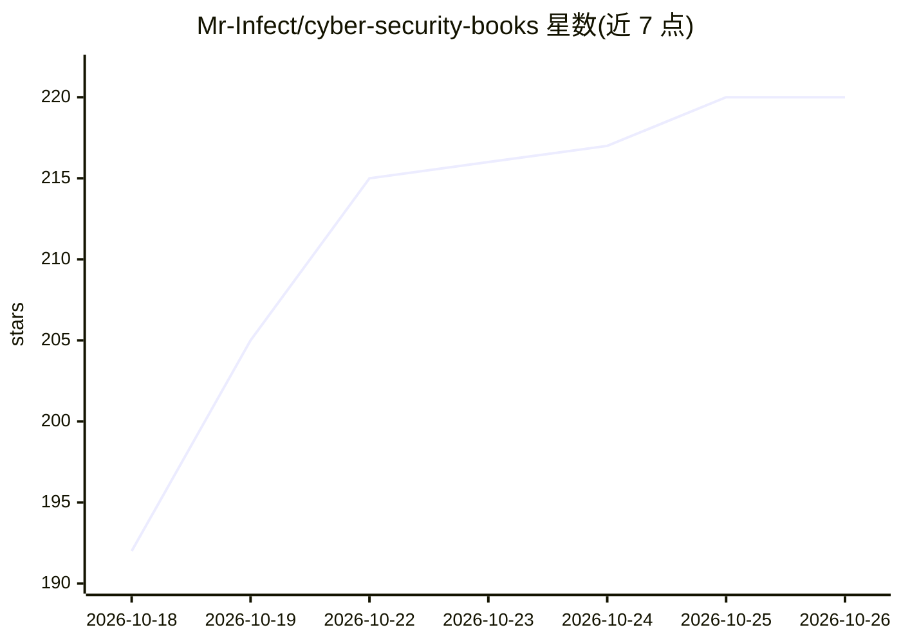

# Mr-Infect/cyber-security-books

⭐ 220 · 推送 2026-02-12 · [GitHub](https://github.com/Mr-Infect/cyber-security-books) · 个人维护

**600+ 本网络安全书籍 PDF 的分类知识库集合**

汇集 600 余本网络安全、渗透测试、密码学、网络协议、数字取证等领域的 PDF 书籍与研究资料，按知识领域分目录组织，面向学生、研究者与安全从业者，可用于结构化学习、认证备考（CEH、Security+、Network+）与学术研究。README 另列出将其转换为向量数据库、RAG 管线、语义问答系统等 AI 用途，并声明所有资料仅限教育、研究与合乎伦理的使用。

## 筛选速览

| 维度 | 判定 | 备注 |
|---|---|---|
| AI 角色 | `ai-knowledge` | 知识聚合/清单类 |
| 许可风险 | `none` | — |
| 部署形态 | `None` |  |
| 模型依赖 | — | README 未给出锁定关系 |
| 硬件要求 | — | 无带数字的原话,不猜 |
| 安装摩擦 | `low` | 无编译、无系统依赖或容器化 |
| 成熟度 | — | 结构信号不足 |

## 能力要点

- 600+ 本分类组织的技术书籍与参考资料
- 覆盖红队/蓝队、密码学、取证、暗网研究等领域
- 包含 CEH、CompTIA Security+、Network+ 认证备考材料
- README 列出 RAG/embedding/语义问答等知识库构建用途

## 适用场景

- 按目录结构化学习网络安全知识与备考认证
- 作为安全领域的文献综述与论文参考资料库
- 转换为向量数据库构建安全领域 RAG 问答系统

## 场景标签

`网络安全` `精选清单` · 领域:学习与行业

## 证据(README 行号)

> L4: A carefully organized, large-scale collection of **cybersecurity and computer security books, research material, and
> L6: This repository serves as a **central knowledge vault** containing high-quality PDFs across core and advanced securi
> L10: ✔ 600+ technical books & references

## 星数曲线

2026-10-18 192 → 2026-10-26 220（+28）

---
*卡片 v1 · prompt 1.4 · 生成 2026-10-22 · 置信度 high · 依据 README sha `7f00841b8c8f` · [字段定义](../../DATASET.md)*
