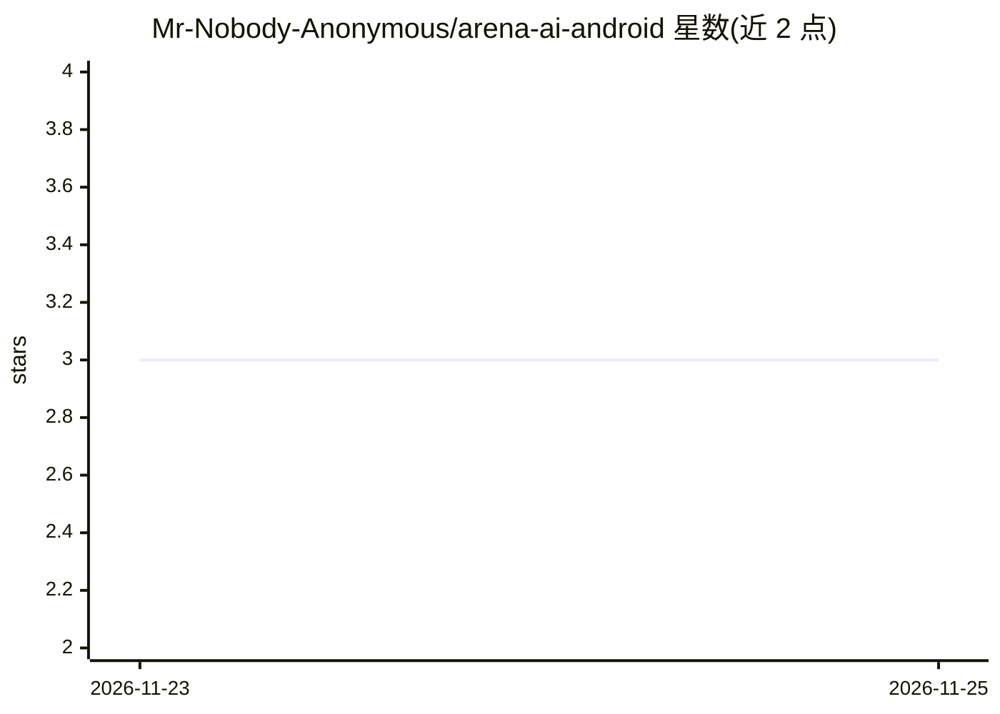

# Mr-Nobody-Anonymous/arena-ai-android

⭐ — · [GitHub]() · 个人维护

**Arena.ai（Chatbot Arena）的非官方原生 Android 客户端**

以 WebView 为核心的单代码库 Android 应用，直连 https://arena.ai，无需伴随服务器；提供盲对模型对战投票、多模态视觉基准、实时 Elo 排行榜浏览与直连模型对话。针对移动端做了页面感知的下拉刷新（防止聊天被误重载）、基于 GitHub Releases 的应用内自更新（SHA-256 与签名校验）、多文件/拍照上传桥接、5 秒自动重连引擎。支持 Android 8.0–15+，APK 采用 v1/v2/v3 签名，零遥测。

## 筛选速览

| 维度 | 判定 | 备注 |
|---|---|---|
| AI 角色 | `ai-ecosystem` | LLM/agent 周边工具 |
| 许可风险 | `permissive` | — |
| 部署形态 | `desktop` | 安装包/桌面程序 |
| 模型依赖 | — | README 未给出锁定关系 |
| 硬件要求 | — | 无带数字的原话,不猜 |
| 安装摩擦 | `low` | 无编译、无系统依赖或容器化 |
| 成熟度 | — | 结构信号不足 |

## 能力要点

- 盲对投票、视觉基准、Elo 排行榜与直连聊天四大功能区
- 页面感知下拉刷新：仅在页面顶部触发，避免误清空对话
- GitHub Releases 自更新：版本比较、SHA-256 与签名者证书校验
- 5 秒倒计时自动重连引擎与 AMOLED 断网页面

## 适用场景

- 在手机上匿名对比两个 LLM 的回答并投票
- 上传图表或截图参与多模态视觉基准
- 查看各类别模型 Elo 排名与置信区间
- 直接与指定模型聊天而不参与盲评

## 场景标签

`聊天机器人` `模型评测` · 领域:对话与助手

## 证据(README 行号)

> L14: An open-source, high-performance native Android application for **Arena (arena.ai)** (formerly LMSYS Chatbot Arena)
> L29: |**Connection Architecture**|**100% Standalone** direct HTTPS to `https://arena.ai` (no companion server, proxy, or
> L50: 1. **Pairwise Blind Battles (Chatbot Arena):**

## 星数曲线

2026-11-23 3 → 2026-11-25 3（+0）

---
*卡片 v1 · prompt 1.4 · 生成 2026-11-23 · 置信度 mid · 依据 README sha `4f2304bde95e` · [字段定义](../../DATASET.md)*
