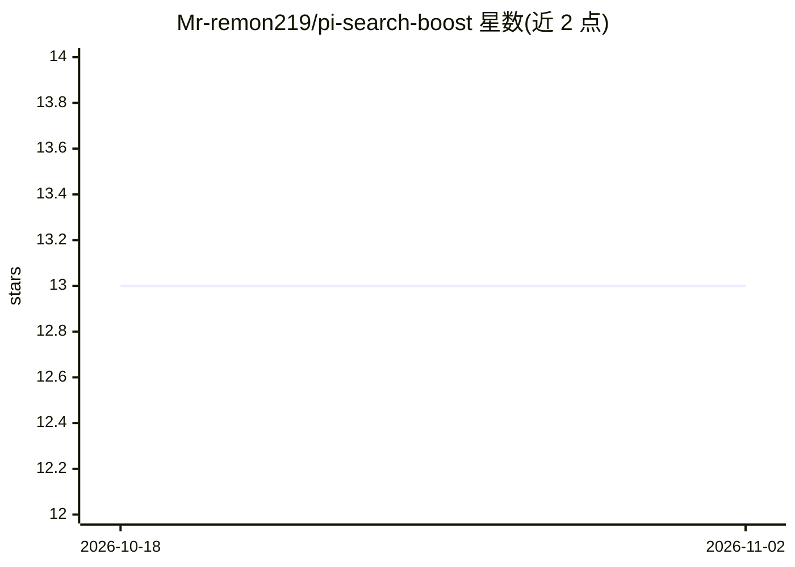

# Mr-remon219/pi-search-boost

⭐ 13 · TypeScript · MIT · 推送 2026-08-30 · [GitHub](https://github.com/Mr-remon219/pi-search-boost) · 个人维护 · 中文 README

**pi 编码代理的搜索增强扩展：多引擎融合检索与深度研究**

面向 pi 编码代理的搜索增强扩展：将 pi 的网络搜索升级为多引擎融合能力，通过 fused_search 并行调用 Tavily/Brave/Exa 并做跨引擎去重排序，提供 fetch_page 焦点过滤读页、deep_research 多轮证据循环、research_parallel 并行子代理研究与 x_search 实时 X/Twitter 搜索等工具。免费层使用免密钥 Exa MCP，API 层需配置至少一个搜索 API key。要求 pi v0.84+ 与 Node.js 22.6+，支持 npm/git/本地安装四种方式，并带 JSONL 审计日志与磁盘缓存。

## 筛选速览

| 维度 | 判定 | 备注 |
|---|---|---|
| AI 角色 | `ai-ecosystem` | LLM/agent 周边工具 |
| 许可风险 | `permissive` | MIT |
| 部署形态 | `library` | 以包/库形式分发 |
| 模型依赖 | locked-api |  |
| 硬件要求 | — | 无带数字的原话,不猜 |
| 安装摩擦 | `low` | 无编译、无系统依赖或容器化 |
| 成熟度 | — | 结构信号不足 |

## 能力要点

- fused_search 并行融合 Tavily/Brave/Exa，跨引擎去重与置信度排序
- 免费层使用免密钥 Exa MCP，无需任何 API key 即可运行
- deep_research 多轮证据循环与 2-4 个并行 pi 子代理研究
- 搜索（6h）与页面（24h）磁盘缓存及全量 JSONL 审计日志

## 适用场景

- 让 pi 代理在编码前查证不确定的 API 信息
- 运行多轮深度研究并要求证据对齐与多域名覆盖
- 通过 x_search 检索 X/Twitter 实时帖文与用户资料

## 场景标签

`Agent 框架` · 领域:Agent 开发

## 证据(README 行号)

> L3: **Search-boost extension for pi — turns pi's web search into a multi-engine, research-grade capability: fused multi-
> L153: |Tool|What it does|

## 星数曲线

2026-10-18 13 → 2026-11-02 13（+0）

---
*卡片 v1 · prompt 1.4 · 生成 2026-10-31 · 置信度 high · 依据 README sha `f234b8495c13` · [字段定义](../../DATASET.md)*
