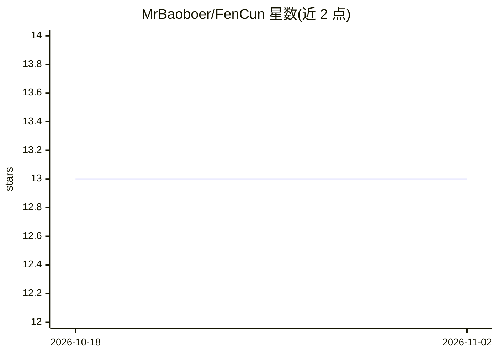

# MrBaoboer/FenCun

⭐ 13 · TypeScript · AGPL-3.0 · 推送 2026-11-01 · [GitHub](https://github.com/MrBaoboer/FenCun) · [官网](https://fencun.vercel.app) · 个人维护 · 中文 README

**香水使用决策 Agent：按实时天气与场合从你的香柜推荐今天用哪瓶怎么用**

面向香水用户的 Next.js Web 应用：结合用户香柜、和风天气实时数据与场合（支持自然语言描述，由 DeepSeek 解析），给出今日用香推荐及喷量、位置、留香区间与风险提示。打分与用法判定由纯 TypeScript 确定性规则引擎在浏览器本地计算，DeepSeek 仅做场景解析与自然语言表达，输出经数字白名单校验，LLM 超时可降级到规则模板。数据存 localStorage 无账号系统，含 3.67 万款香水中文目录、香历与反馈闭环。需 Node 24 本地运行。

## 筛选速览

| 维度 | 判定 | 备注 |
|---|---|---|
| AI 角色 | `ai-native` | 本体是模型或模型工具 |
| 许可风险 | `viral` | AGPL-3.0 |
| 部署形态 | `library` | 以包/库形式分发 |
| 模型依赖 | locked-api |  |
| 硬件要求 | — | 无带数字的原话,不猜 |
| 安装摩擦 | `low` | 无编译、无系统依赖或容器化 |
| 成熟度 | — | 结构信号不足 |

## 能力要点

- 规则引擎决策 + DeepSeek 表达的分层架构，LLM 输出过数字白名单
- good/caution/avoid 三档裁决与急性天气/场合预警
- 香柜×实时天气×场合的打分推荐，附喷量档位与留香区间
- 浏览器 localStorage 持久化，无 key 也能降级运行

## 适用场景

- 站在香柜前决定今天喷哪瓶、喷多少、喷在哪
- 去婚礼、见投资人等特定场合前获取用香建议
- 记录每日用香并按反馈修正个人偏好

## 场景标签

 · 领域:生活方式/消费决策

## 证据(README 行号)

> L5: 一个基于实时情境的个人 **「用香决策」Agent**：
> L52: **决策权在规则引擎，表达权在 LLM。** 匹配打分、喷量与留香判定全部由确定性规则计算，可解释、可复现、有单测；DeepSeek 只做两件事——听懂自然语言场景、把规则算好的事实翻成人话。天气永远来自和风天气 API，由服务端

## 星数曲线

2026-10-18 13 → 2026-11-02 13（+0）

---
*卡片 v1 · prompt 1.4 · 生成 2026-10-31 · 置信度 high · 依据 README sha `7093ba836fbb` · [字段定义](../../DATASET.md)*
