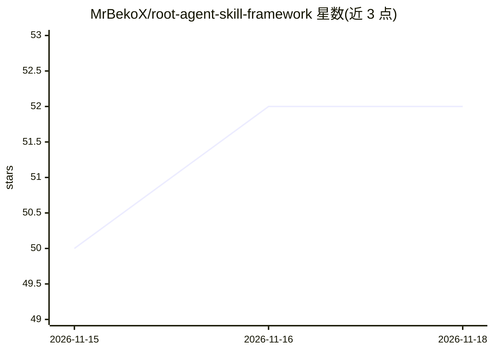

# MrBekoX/root-agent-skill-framework

⭐ 52 · Python · MIT · 推送 2026-11-15 · [GitHub](https://github.com/MrBekoX/root-agent-skill-framework) · 个人维护

**运行在 Grok Bot 上的多 Bot 协调者技能与模板框架**

面向 Grok Bot 平台的提示词与技能工程项目（非代码项目）：提供 Root Agent 协调者 Bot 的描述、19 个技能与 2 个可选 Lead 技能，把文本复制或附加到 Grok Bot 中使用。机制上按四级分层模型（tier 0-3）评估请求规模、创建所需 Bot 团队、把日常管理委托给 Lead，并保留独立评审门与交付证据链。限制：文本为英文，live Grok Bot 行为未对照 0.3.11 版本验证，所有 live 用例标记 NOT RUN；通过分享链接 Add to Grok Bot 获取。

## 筛选速览

| 维度 | 判定 | 备注 |
|---|---|---|
| AI 角色 | `ai-ecosystem` | LLM/agent 周边工具 |
| 许可风险 | `permissive` | MIT |
| 部署形态 | `None` |  |
| 模型依赖 | locked-api |  |
| 硬件要求 | — | 无带数字的原话,不猜 |
| 安装摩擦 | `low` | 无编译、无系统依赖或容器化 |
| 成熟度 | `idea` | |

## 能力要点

- 19 个 Root 技能 + 2 个可选 Lead 技能，每个技能统一六段结构
- tier 0-3 分层模型：按范围而非措辞决定团队结构，无固定人数
- Lead 交接包带交付键与读回门（readback gate），防止重复执行
- 离线验证：Markdown 链接对照本地清单检查，阻止外部文件系统访问

## 适用场景

- 在 Grok Bot 上自动组建 Bot 团队处理多领域请求
- 需要独立评审与交付证据的任务编排
- 希望只提需求、不手动设计 Bot 团队的用户

## 场景标签

`Agent 框架` `多智能体` `提示工程` · 领域:Agent 开发

## 证据(README 行号)

> L5: This repository is the source for the description, skills and templates of **Root Agent**, a coordinator Bot that ru
> L33: Root Agent is the user's single entry point. The user writes what they want and never has to create a Bot or design

## 星数曲线

2026-11-15 50 → 2026-11-18 52（+2）

---
*卡片 v1 · prompt 1.4 · 生成 2026-11-18 · 置信度 high · 依据 README sha `9bae45e21147` · [字段定义](../../DATASET.md)*
