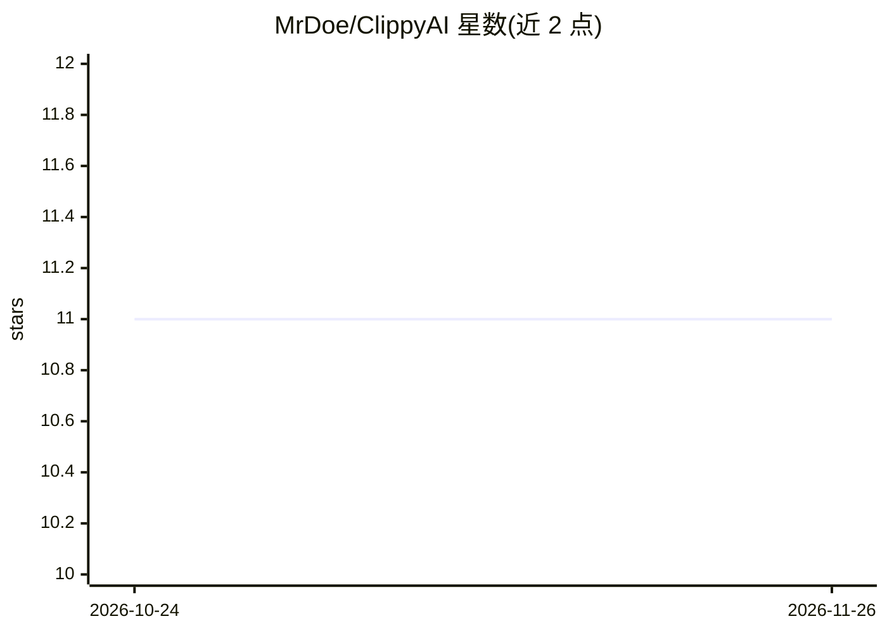

# MrDoe/ClippyAI

⭐ 11 · C# · MIT · 推送 2026-11-09 · [GitHub](https://github.com/MrDoe/ClippyAI) · [官网](https://github.com/MrDoe/ClippyAI) · 个人维护

**调用本地 Ollama 处理剪贴板内容的桌面 AI 助手**

基于 .NET 与 Avalonia 开发的跨平台桌面 GUI 应用：读取剪贴板内容并发送任务到本地 Ollama（或云端 OpenAI API），生成结果写回剪贴板供粘贴。支持任务级 prompt/模型/参数配置、内嵌 LanceDB 向量数据库做模板缓存、剪贴板历史（SQLite+PNG，200 条上限）、图像分析（剪贴板/摄像头）、自动生成 Markdown 应用手册、ClickHouse RAG 检索增强与全局热键。提供 Windows .msi 与 Linux .deb/.rpm 安装包，README 声明处于早期开发阶段。

## 筛选速览

| 维度 | 判定 | 备注 |
|---|---|---|
| AI 角色 | `ai-native` | 本体是模型或模型工具 |
| 许可风险 | `permissive` | MIT |
| 部署形态 | `desktop` | 安装包/桌面程序 |
| 模型依赖 | local-ok | 支持本地模型 |
| 硬件要求 | — | 无带数字的原话,不猜 |
| 安装摩擦 | `low` | 无编译、无系统依赖或容器化 |
| 成熟度 | `idea` | |

## 能力要点

- 剪贴板进出：复制内容→本地 LLM 处理→结果写回剪贴板
- 内嵌 LanceDB 向量库做输出模板缓存，无需外部数据库服务
- 支持图像分析任务（剪贴板图片/摄像头捕获）与视觉模型配置
- SSH 隧道连接远程 Ollama/OpenAI 实例，全局热键触发任务

## 适用场景

- 复制邮件让 AI 起草回复，粘贴回邮件客户端
- 复制代码段让 AI 查找错误
- 翻译或总结长文本
- 用摄像头拍摄文档做 OCR 图像分析

## 场景标签

`AI 助手` · 领域:对话与助手

## 证据(README 行号)

> L5: ClippyAI is an innovative tool which enables you to use local AI more efficiently for your daily tasks. It takes the
> L21: * **Ollama and OpenAI Integration**: Choose between local Ollama or cloud-based OpenAI API for AI processing, provi
> L26: * **Cross-Platform Support**: Developed with .NET and Avalonia, ClippyAI runs on Windows and Linux (X11), ensuring 

## 星数曲线

2026-10-24 11 → 2026-11-26 11（+0）

---
*卡片 v1 · prompt 1.4 · 生成 2026-11-19 · 置信度 high · 依据 README sha `68362317a74d` · [字段定义](../../DATASET.md)*
