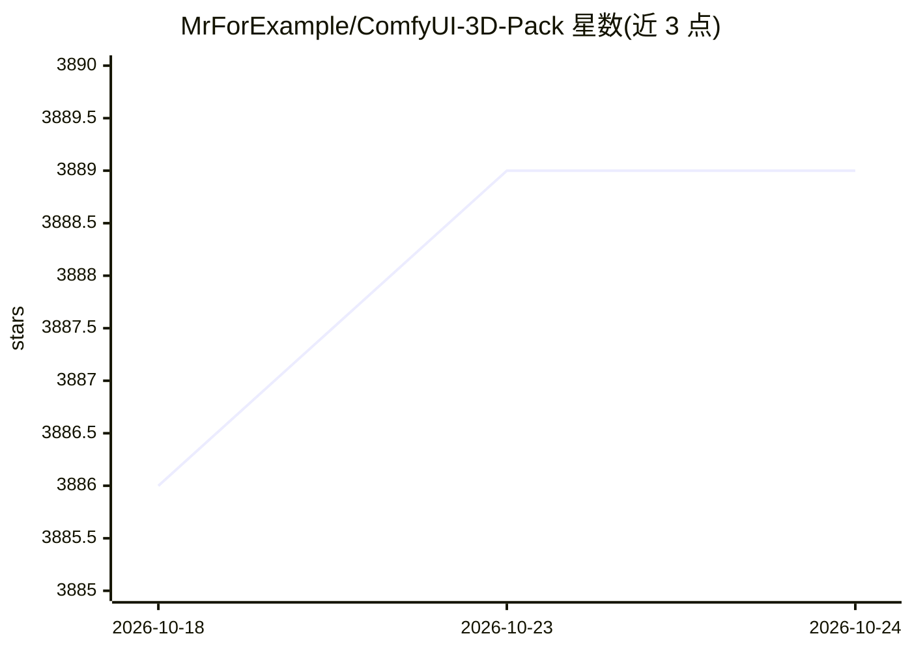

# MrForExample/ComfyUI-3D-Pack

⭐ 3,889 · Python · MIT · 推送 2025-12-29 · [GitHub](https://github.com/MrForExample/ComfyUI-3D-Pack) · 个人维护

**ComfyUI 的 3D 资产生成节点套件（图生 3D 模型）**

为 ComfyUI 扩展 3D 处理能力的自定义节点套件：集成约二十个图生 3D 模型（Hunyuan3D、TRELLIS、TripoSR、CRM、InstantMesh、PartCrafter 等），支持单图/多视图生成 3D Mesh、UV 纹理、法线图与 3D Gaussian，并在 ComfyUI 内可视化预览 3DGS 与网格。安装可经 ComfyUI-Manager、WinPortable 预编译包或手动 git clone；Windows/Linux 部分节点需安装 Visual Studio Build Tools 或 gcc/g++ 做运行时 JIT 编译，另提供 Docker 说明。

## 筛选速览

| 维度 | 判定 | 备注 |
|---|---|---|
| AI 角色 | `ai-ecosystem` | LLM/agent 周边工具 |
| 许可风险 | `permissive` | MIT |
| 部署形态 | `None` |  |
| 模型依赖 | — | README 未给出锁定关系 |
| 硬件要求 | — | 无带数字的原话,不猜 |
| 安装摩擦 | `high` | 编译与系统依赖俱全 |
| 成熟度 | — | 结构信号不足 |

## 能力要点

- 单图/多视图到 3D Mesh、RGB 纹理、法线图与 3D Gaussian 的多模型流水线
- 集成 Hunyuan3D 2.1/V2/V1、TRELLIS、TripoSG、PartCrafter 等模型节点
- 基于 gsplat.js 与 three.js 的 ComfyUI 内 3DGS 与网格可视化预览
- 提供 Windows 预编译包（Python 3.12/CUDA 12.4）与 install.py 自动匹配安装

## 适用场景

- 在 ComfyUI 工作流中用一张图生成带纹理的 3D 模型
- 生成多视图图像与法线图用于 3D 重建
- 预览与转换 3D Gaussian 表示为网格

## 场景标签

 · 领域:3D 生成/AI 创作工具

## 证据(README 行号)

> L4: This is an extensive node suite that enables ComfyUI to process 3D inputs (Mesh & UV Texture, etc.) using cutting ed
> L218: - **Preview 3DGS and 3D Mesh**: 3D Visualization inside ComfyUI:

## 星数曲线

2026-10-18 3,886 → 2026-10-24 3,889（+3）

---
*卡片 v1 · prompt 1.4 · 生成 2026-10-21 · 置信度 high · 依据 README sha `d1c759f1e364` · [字段定义](../../DATASET.md)*
