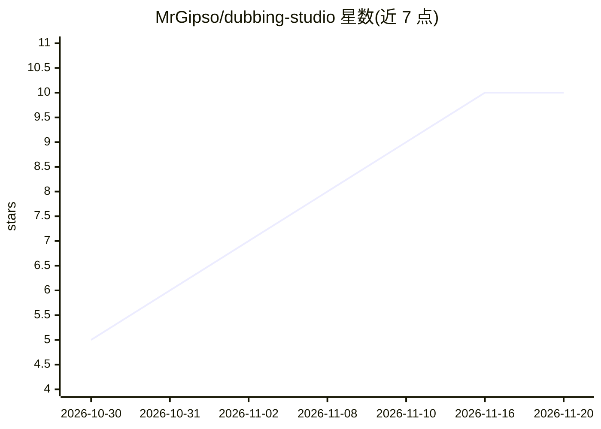

# MrGipso/dubbing-studio

⭐ 10 · Python · MIT · 推送 2026-10-30 · [GitHub](https://github.com/MrGipso/dubbing-studio) · 个人维护

**本地视频配音桌面应用：Whisper+LLM 翻译+语音克隆**

在本地电脑上完成视频/音频配音的流水线工具：Demucs 分离人声与背景音、Whisper 转录、任意 LLM 翻译、任意 TTS 引擎（含语音克隆）配音并重新合成视频。支持单项目中多语言、多说话人自动识别与逐人配音、时长对齐（加速或变调拉伸、−16 LUFS 响度归一）。以 Tauri/Python 桌面应用提供，Windows 有安装包，macOS/Linux 经 setup.sh/start.sh 启动（官方声明未经验证）。限制包括同时说话时的归属错误与 OmniVoice 权重的非商业许可。

## 筛选速览

| 维度 | 判定 | 备注 |
|---|---|---|
| AI 角色 | `ai-native` | 本体是模型或模型工具 |
| 许可风险 | `permissive` | MIT |
| 部署形态 | `desktop` | 安装包/桌面程序 |
| 模型依赖 | local-ok | 支持本地模型 |
| 硬件要求 | — | 无带数字的原话,不猜 |
| 安装摩擦 | `medium` | 含编译或系统依赖之一 |
| 成熟度 | — | 结构信号不足 |

## 能力要点

- 流水线：人声分离→Whisper 转录→LLM 翻译→TTS 配音→合成视频
- 多说话人自动识别，每人用克隆的原始声音配音
- 翻译模型可接本地（LM Studio/Ollama/llama.cpp/KoboldCpp/Jan/vLLM）或云端 API
- 单项目多语言，模型引擎可通过 engines/_template 自定义接入

## 适用场景

- 给外语视频做本地配音并保留背景音乐
- 多说话人视频按说话人分别配音
- 同一视频一次性生成多种语言译制版

## 场景标签

`语音合成` `语音识别` `图像视频处理` · 领域:内容生成

## 证据(README 行号)

> L6: видео ─► отделение голоса от фона ─► Whisper ─► любая LLM (перевод) ─► любой TTS-движок (озвучка) ─► видео с дубляжо
> L14: - **Перевод любой моделью.** LM Studio, Ollama, llama.cpp, KoboldCpp, Jan, vLLM
> L41: - Windows 10/11, macOS или Linux. Проверено на Windows. В macOS и Linux

## 星数曲线

2026-10-30 5 → 2026-11-20 10（+5）

---
*卡片 v1 · prompt 1.4 · 生成 2026-11-20 · 置信度 high · 依据 README sha `175083e1a941` · [字段定义](../../DATASET.md)*
