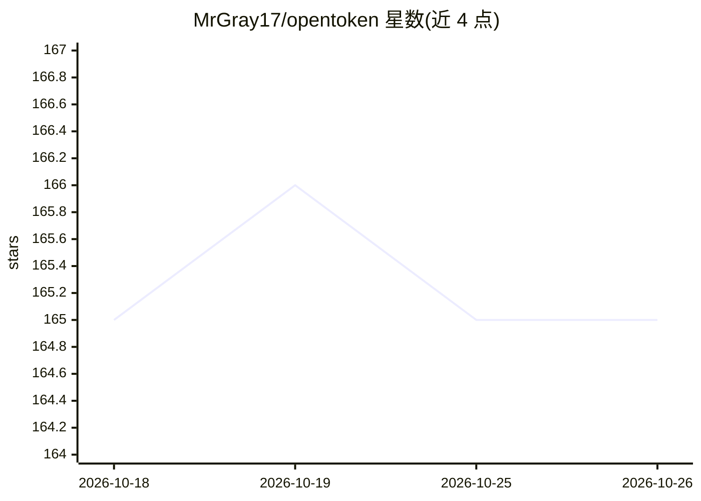

# MrGray17/opentoken

⭐ 165 · TypeScript · MIT · 推送 2026-05-29 · [GitHub](https://github.com/MrGray17/opentoken) · [官网](https://www.npmjs.com/package/@mrgray17/opentoken) · 个人维护

**AI 编程 agent 的工具输出压缩引擎，降低 LLM 输入 token 消耗**

拦截 AI 编程助手调用 shell 命令产生的原始输出，经 35+ 压缩阶段（ANSI 剥离、日志/重复折叠、LTSC/LZW 压缩、路径缩短等）过滤噪声后再送入 LLM 上下文。每个阶段末尾有保守安全过滤：输出若变大则原样返回，并前置密钥脱敏与二进制检测。按 10 个命令族路由专用流水线，另有 46 种预调用重写模式。面向使用 OpenCode、Cursor、Claude Desktop 等 MCP 兼容 IDE 的开发者，以 OpenCode 插件、MCP 服务器、CLI 与 npm 库四种形式分发，需 Bun v1.2+ 或 Node.js >=18 运行时。

## 筛选速览

| 维度 | 判定 | 备注 |
|---|---|---|
| AI 角色 | `ai-ecosystem` | LLM/agent 周边工具 |
| 许可风险 | `permissive` | MIT |
| 部署形态 | `library` | 以包/库形式分发 |
| 模型依赖 | — | README 未给出锁定关系 |
| 硬件要求 | — | 无带数字的原话,不猜 |
| 安装摩擦 | `low` | 无编译、无系统依赖或容器化 |
| 成熟度 | — | 结构信号不足 |

## 能力要点

- 35+ 压缩阶段 + 每阶段保守安全过滤（输出只缩不涨）
- 10 个命令族专用流水线与 46 种预调用重写模式
- 四种分发形式：OpenCode 插件 / MCP 服务器 / CLI / npm 库
- 密钥脱敏、二进制检测、50KB 以上输入跳过压缩

## 适用场景

- 降低 AI 编程助手的工具输出 token 消耗
- 在长会话中避免重复输出占用上下文窗口
- 接入 Cursor / Claude Desktop / VS Code Copilot 等 MCP 兼容 IDE

## 场景标签

 · 领域:AI 编程工具/LLM 基础设施

## 证据(README 行号)

> L3: **Token-compression engine for AI coding agents.**
> L17: OpenToken is a transparent filter between tool runtime and LLM context window. Every output passes through 35 compr

## 星数曲线

2026-10-18 165 → 2026-10-26 165（+0）

---
*卡片 v1 · prompt 1.4 · 生成 2026-10-23 · 置信度 high · 依据 README sha `884d2311b807` · [字段定义](../../DATASET.md)*
