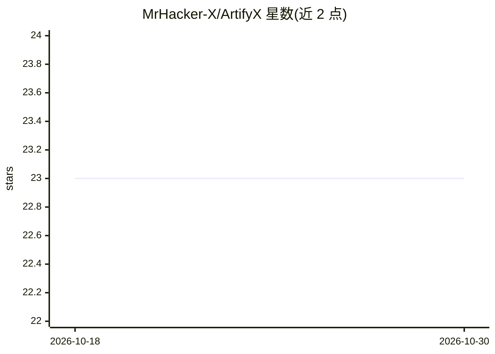

# MrHacker-X/ArtifyX

⭐ 23 · Python · MIT · 推送 2026-10-16 · [GitHub](https://github.com/MrHacker-X/ArtifyX) · 个人维护

**终端文生图工具：一个提示词经 OpenAI DALL·E 生成多张图**

Python 命令行工具，在终端输入提示词后调用 OpenAI Images API（dall-e-2/dall-e-3），每次生成最多 10 张 PNG 并保存到本地（Termux 为 /sdcard/ArtifyX，桌面为 ~/ArtifyX）。面向个人创意用户，v2.0 升级到 openai SDK v1+，提供跨平台 setup.sh（Termux/apt/dnf/pacman/apk）、启动时配置与鉴权校验、单次调用生成多图。依赖仅 openai 与 rich 两个包；每张图按用户 API key 计费，自述为个人创意工具而非批量生成服务。

## 筛选速览

| 维度 | 判定 | 备注 |
|---|---|---|
| AI 角色 | `ai-native` | 本体是模型或模型工具 |
| 许可风险 | `permissive` | MIT |
| 部署形态 | `library` | 以包/库形式分发 |
| 模型依赖 | locked-api |  |
| 硬件要求 | — | 无带数字的原话,不猜 |
| 安装摩擦 | `low` | 无编译、无系统依赖或容器化 |
| 成熟度 | — | 结构信号不足 |

## 能力要点

- 一次提示词单次 API 调用生成 1-10 张 PNG（dall-e-2），dall-e-3 单张
- 跨平台 setup.sh 检测 Termux 与 4 种 Linux 包管理器并校验依赖
- 启动时校验模型/尺寸组合与 API key，错误不中断循环
- 仅需 openai 与 rich 两个 Python 依赖

## 适用场景

- 在手机 Termux 或桌面终端快速把想法转成图片
- 不想用网页应用或重量级框架的轻量文生图
- 在终端里连续输入提示词批量个人创作并自动存 PNG

## 场景标签

`图像生成` · 领域:内容生成

## 证据(README 行号)

> L27: |2️⃣|**Generate**|ArtifyX calls the OpenAI images API (`dall-e-2` / `dall-e-3`)|
> L148: |AI|`openai` SDK v1+ — Images API (`b64_json` responses)|

## 星数曲线

2026-10-18 23 → 2026-10-30 23（+0）

---
*卡片 v1 · prompt 1.4 · 生成 2026-10-27 · 置信度 mid · 依据 README sha `8ede4641bf83` · [字段定义](../../DATASET.md)*
