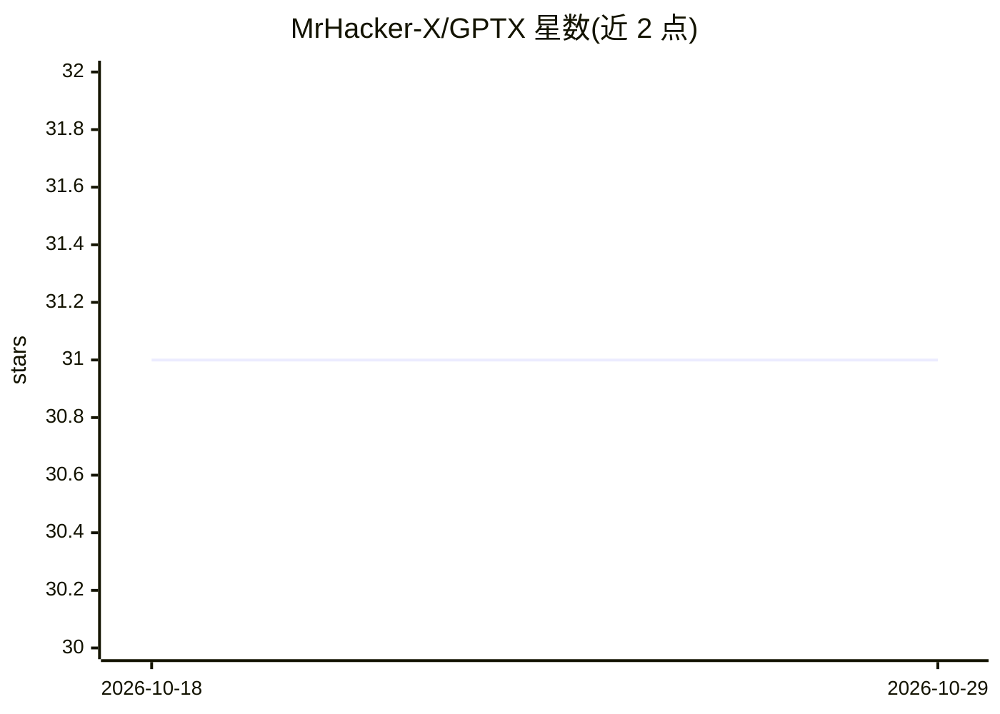

# MrHacker-X/GPTX

⭐ 31 · Python · MIT · 推送 2026-10-16 · [GitHub](https://github.com/MrHacker-X/GPTX) · 个人维护

**终端里的 ChatGPT 循环：提问即流式获得回答**

基于 Python 的终端 AI 聊天工具：调用 OpenAI SDK v1+ Chat Completions API（默认 gpt-4o-mini，可配置任意 OpenAI 聊天模型），回答逐 token 流式打印到终端，形成一个提问-回答循环，无 Web UI。setup.sh 自动检测 Termux 与四类 Linux 包管理器（apt/dnf/pacman/apk）及 macOS，安装结束逐项校验依赖；API key 经 config.py 或环境变量提供，不写入仓库。依赖仅 openai 与 rich 两个包。声明为个人助手工具，按 token 计费、需遵守 OpenAI 使用政策。

## 筛选速览

| 维度 | 判定 | 备注 |
|---|---|---|
| AI 角色 | `ai-native` | 本体是模型或模型工具 |
| 许可风险 | `permissive` | MIT |
| 部署形态 | `library` | 以包/库形式分发 |
| 模型依赖 | — | README 未给出锁定关系 |
| 硬件要求 | — | 无带数字的原话,不猜 |
| 安装摩擦 | `low` | 无编译、无系统依赖或容器化 |
| 成熟度 | — | 结构信号不足 |

## 能力要点

- OpenAI Chat Completions 流式输出到终端
- setup.sh 支持 Termux 与 apt/dnf/pacman/apk/macOS 五种环境检测
- 依赖仅 openai 与 rich 两个包
- API key 经环境变量或 config.py 提供，支持 GPTX_MODEL/GPTX_MAX_TOKENS 配置

## 适用场景

- 在终端直接向 ChatGPT 提问并流式阅读回答
- 在 Android Termux 上使用命令行 AI 助手
- 用环境变量切换模型与回复长度上限

## 场景标签

`AI 助手` `聊天机器人` · 领域:对话与助手

## 证据(README 行号)

> L3: ### *ChatGPT in your terminal - one prompt loop, streamed answers, zero web UI.*
> L27: |2️⃣|**Stream**|The OpenAI chat model replies, printing token-by-token (`◆ GPTX ›`)|
> L128: |AI|`openai` SDK v1+ — streamed Chat Completions|

## 星数曲线

2026-10-18 31 → 2026-10-29 31（+0）

---
*卡片 v1 · prompt 1.4 · 生成 2026-10-26 · 置信度 mid · 依据 README sha `99341ea1f2cb` · [字段定义](../../DATASET.md)*
