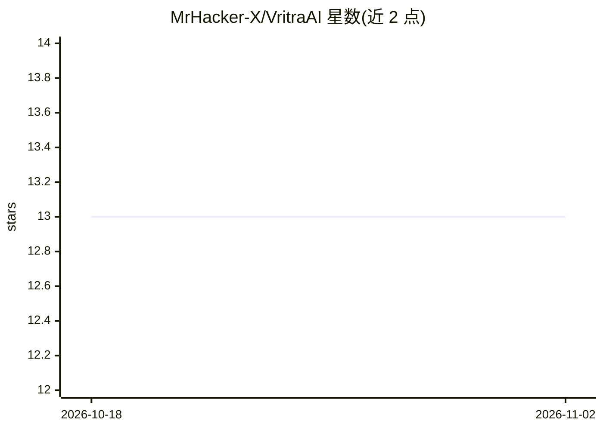

# MrHacker-X/VritraAI

⭐ 13 · Python · MIT · 推送 2026-10-16 · [GitHub](https://github.com/MrHacker-X/VritraAI) · [官网](https://vritraai.vritrasec.com) · 个人维护

**终端本地 AI 编程 agent，多模型+工具执行+diff 审批**

面向 Termux/Linux/macOS 终端的 AI 编程 agent：以纯文本任务驱动 agent 循环，调用读/写/编辑/shell/verify/git/todo 工具，多文件批量写入并拒绝空壳代码。支持 Gemini、OpenRouter、Groq、Mistral、NVIDIA 多 provider，免费层 failover 路由。所有写入与 shell 命令经审批门控（ask/auto/safe 三档），另有 /review /security /doc 等斜杠命令。pip 安装，需 Python 3.9+ 与至少一个 API key。

## 筛选速览

| 维度 | 判定 | 备注 |
|---|---|---|
| AI 角色 | `ai-ecosystem` | LLM/agent 周边工具 |
| 许可风险 | `permissive` | MIT |
| 部署形态 | `library` | 以包/库形式分发 |
| 模型依赖 | locked-api |  |
| 硬件要求 | — | 无带数字的原话,不猜 |
| 安装摩擦 | `low` | 无编译、无系统依赖或容器化 |
| 成熟度 | — | 结构信号不足 |

## 能力要点

- 终端 agent 循环：读仓库、多文件编辑、运行 shell、验证、finish_task 结束
- 多 provider 支持（Gemini/OpenRouter/Groq/Mistral/NVIDIA）与免费层 failover 路由
- diff 审批门控（ask/auto/safe）与工作区信任模式
- 纯 Python requests 客户端，不依赖 openai/jiter，可在 Termux 运行

## 适用场景

- 在终端用自然语言让 agent 搭建/修复/重构项目代码
- 手机 Termux 环境下用免费 API key 做本地编程 agent
- 带 diff 审批地执行代码审查与安全扫描

## 场景标签

`编码 Agent` `代码审查` · 领域:编码与开发

## 证据(README 行号)

> L13: > VritraAI runs an **agent loop** in your terminal: read the repo, edit multiple
> L45: |Product model|AI-enhanced interactive shell|✅ full coding agent|

## 星数曲线

2026-10-18 13 → 2026-11-02 13（+0）

---
*卡片 v1 · prompt 1.4 · 生成 2026-10-31 · 置信度 high · 依据 README sha `20de3f14decd` · [字段定义](../../DATASET.md)*
