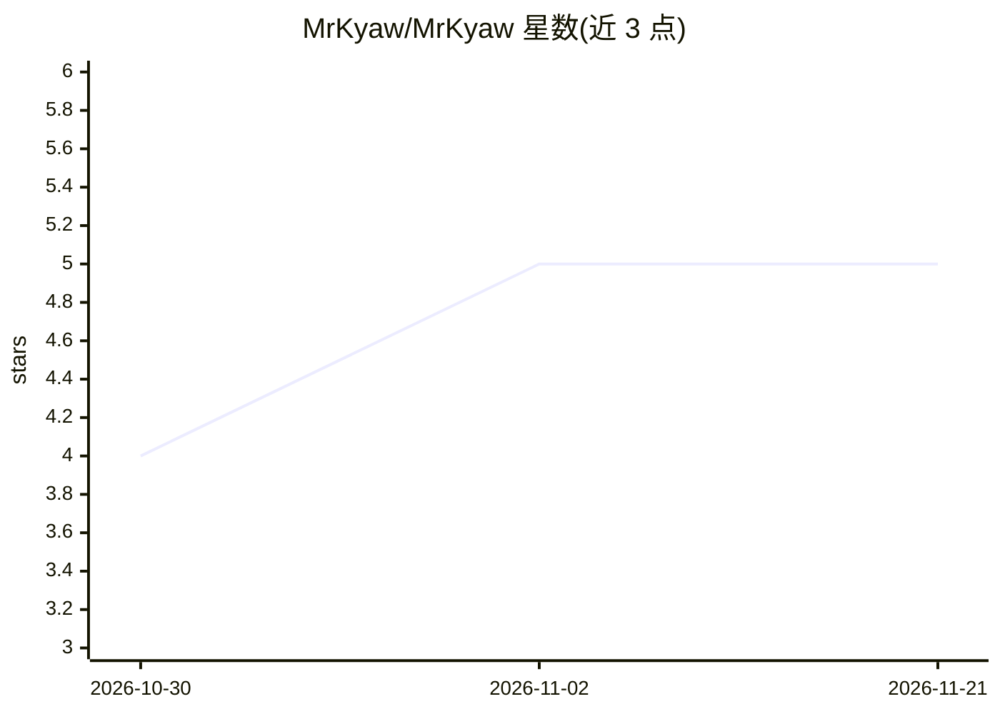

# MrKyaw/MrKyaw

⭐ 5 · 推送 2026-11-17 · [GitHub](https://github.com/MrKyaw/MrKyaw) · [官网](https://mrkyaw.github.io/kyawkyawoo) · 个人维护

**AI 架构师 Kyaw Kyaw Oo 的个人简历主页**

个人档案页，展示 Principal AI Engineer / Forward-Deployed AI Architect Kyaw Kyaw Oo 的职业信息：PRIME 工程方法论（生产就绪、快速、智能、可度量、高效）、13 个可运行项目的结果表格、上游贡献（DeepEval 等 PR）、企业交付记录、5 篇发表论文与进行中的研究项目。含 LinkedIn/Portfolio/Scholar 等外链。不含安装与运行说明，属职业履历与项目索引性质。

## 筛选速览

| 维度 | 判定 | 备注 |
|---|---|---|
| AI 角色 | `ai-knowledge` | 知识聚合/清单类 |
| 许可风险 | `none` | — |
| 部署形态 | `None` |  |
| 模型依赖 | — | README 未给出锁定关系 |
| 硬件要求 | — | 无带数字的原话,不猜 |
| 安装摩擦 | `low` | 无编译、无系统依赖或容器化 |
| 成熟度 | — | 结构信号不足 |

## 能力要点

- 13 个项目的结果与验证范围表格（AgentForge、Agentic Ops 等）
- PRIME 五字母 AI 工程方法论说明
- 5 篇已发表论文与 4 个进行中研究项目链接
- 对 DeepEval/promptfoo/vLLM 的上游贡献记录

## 适用场景

- 了解该 AI 架构师的背景与项目履历
- 查找其项目仓库与论文入口
- 评估其企业级 AI 交付记录

## 场景标签

 · 领域:个人档案/知识聚合

## 证据(README 行号)

> L1: Kyaw Kyaw Oo
> L36: ## 🔍 Selected Proof — Public and Clickable
> L87: View publication record on Google Scholar

## 星数曲线

2026-10-30 4 → 2026-11-21 5（+1）

---
*卡片 v1 · prompt 1.4 · 生成 2026-11-21 · 置信度 high · 依据 README sha `7e0a4048f28a` · [字段定义](../../DATASET.md)*
