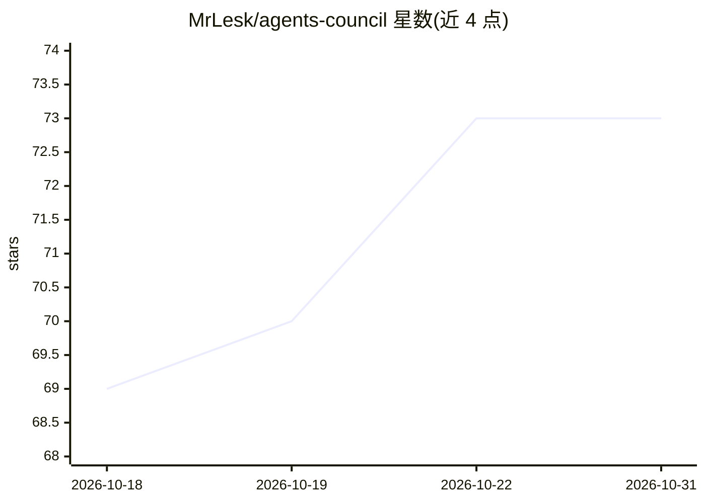

# MrLesk/agents-council

⭐ 73 · TypeScript · MIT · 推送 2026-02-22 · [GitHub](https://github.com/MrLesk/agents-council) · [官网](https://agents-council.com) · 个人维护

**让多个 AI Agent 会话通过 MCP 互相协作讨论的 CLI 工具**

面向已有活跃 agent 会话的开发者，提供基于 MCP stdio server 的集中式 agent 间通信：Claude Code、Codex、Gemini、Cursor 等会话可通过 start_council/join_council 等工具在同一会话中交换反馈。支持通过本地 CLI 认证召唤 Claude 或 Codex 参与讨论，提供本地桌面 Council Hall 供人类监视或参与，状态存储于 ~/.agents-council/state.json。需 Node.js 或 Bun，MCP 模式可经 npx 零安装使用；项目自标注为实验性。

## 筛选速览

| 维度 | 判定 | 备注 |
|---|---|---|
| AI 角色 | `ai-ecosystem` | LLM/agent 周边工具 |
| 许可风险 | `permissive` | MIT |
| 部署形态 | `library` | 以包/库形式分发 |
| 模型依赖 | locked-api |  |
| 硬件要求 | — | 无带数字的原话,不猜 |
| 安装摩擦 | `low` | 无编译、无系统依赖或容器化 |
| 成熟度 | `idea` | |

## 能力要点

- MCP stdio server 集中式 agent 通信，提供 6 个 MCP 工具
- Summon 功能复用本地 CLI 认证召唤 Claude 或 Codex
- 本地桌面 Council Hall 供人类监视或加入讨论
- MCP 模式可经 npx/bunx 零安装使用

## 适用场景

- 让 Claude Code 与 Codex 等多个 agent 会话就同一问题互相评审
- 在 agent 讨论完成后由人类接管会话继续工作
- 通过桌面界面旁观或参与多 agent 讨论

## 场景标签

`多智能体` · 领域:Agent 开发

## 证据(README 行号)

> L16: Inspired by Andrej Karpathy's LLM Council, it provides an MCP-based CLI tool that lets multiple agents communicate 
> L20: - **Centralized agent communication** via MCP stdio server (no complex peer-to-peer networking).

## 星数曲线

2026-10-18 69 → 2026-10-31 73（+4）

---
*卡片 v1 · prompt 1.4 · 生成 2026-10-24 · 置信度 high · 依据 README sha `6df9803dc5a0` · [字段定义](../../DATASET.md)*
