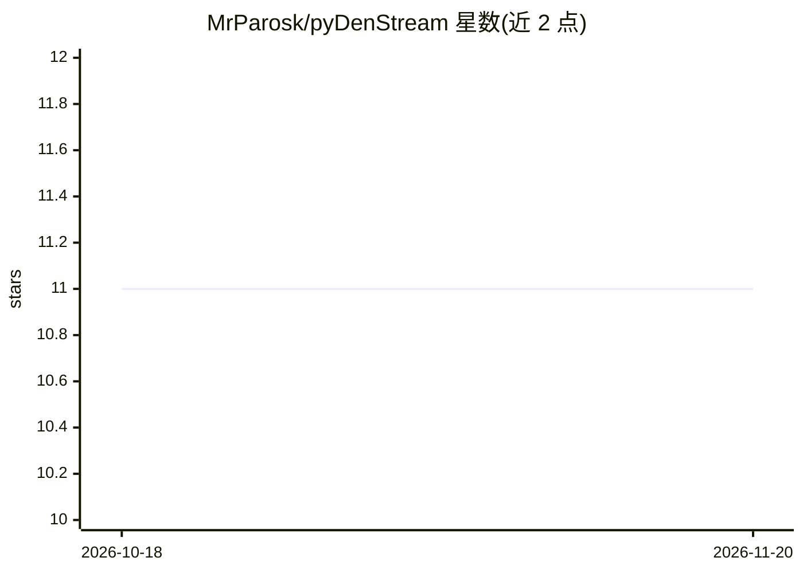

# MrParosk/pyDenStream

⭐ — · [GitHub]() · 个人维护

**Python 实现的 DenStream 数据流密度聚类算法库**

在 Python 中实现 DenStream（带噪声的演化数据流密度聚类）算法，读取数据流并生成聚类结果，属于无监督聚类机器学习库。通过 pip 安装，提供从 denstream 包导入 DenStream 类的使用示例，并在 examples/user_guide.ipynb 中提供更深入的使用指南 notebook。

## 筛选速览

| 维度 | 判定 | 备注 |
|---|---|---|
| AI 角色 | `ai-native` | 本体是模型或模型工具 |
| 许可风险 | `permissive` | — |
| 部署形态 | `library` | 以包/库形式分发 |
| 模型依赖 | — | README 未给出锁定关系 |
| 硬件要求 | — | 无带数字的原话,不猜 |
| 安装摩擦 | `low` | 无编译、无系统依赖或容器化 |
| 成熟度 | — | 结构信号不足 |

## 能力要点

- DenStream 演化数据流密度聚类算法的 Python 实现
- pip 安装，提供 DenStream 类直接调用
- 附带 user_guide.ipynb 深度使用示例

## 适用场景

- 对持续到达的数据流做在线密度聚类
- 流式数据中识别并分离噪声点
- 学习 DenStream 算法的实现与用法

## 场景标签

 · 领域:机器学习/流数据聚类

## 证据(README 行号)

> L5: Implementation of the algorithm Density-Based Clustering over an Evolving Data Stream with Noise in Python.
> L10: pip install denstream

## 星数曲线

2026-10-18 11 → 2026-11-20 11（+0）

---
*卡片 v1 · prompt 1.4 · 生成 2026-11-19 · 置信度 high · 依据 README sha `5922c65ba0c2` · [字段定义](../../DATASET.md)*
