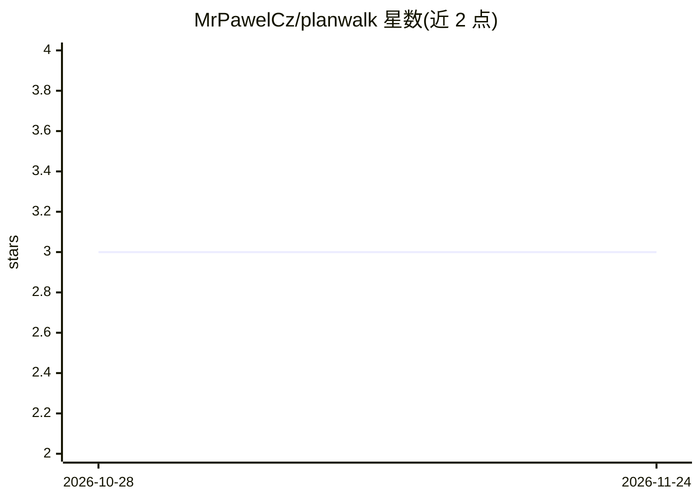

# MrPawelCz/planwalk

⭐ 3 · JavaScript · MIT · 推送 2026-11-02 · [GitHub](https://github.com/MrPawelCz/planwalk) · [官网](https://mrpawelcz.github.io/planwalk/) · 个人维护

**把户型图转成可行走的 3D 户型：JSON 格式+校验器+单文件查看器**

planwalk 定义一个户型平面图 JSON 格式，配套校验器、单 HTML 文件查看器与 GLB 导出。流程是：将户型图图片与提示词交给能读图的聊天模型（或加载 skill 文件夹的 agent）生成 plan.json，校验器给出可被 AI 执行的错误说明，用户在浏览器查看器中获得娃娃屋视图、分层展开、第一人称行走、链接分享与内嵌户型的独立 HTML。无服务器、无运行时依赖、不上传数据。README 附带合成图与真实房源图的基准数据，并说明真实图纸读取结果参差、需人工核对。

## 筛选速览

| 维度 | 判定 | 备注 |
|---|---|---|
| AI 角色 | `ai-native` | 本体是模型或模型工具 |
| 许可风险 | `permissive` | MIT |
| 部署形态 | `None` |  |
| 模型依赖 | — | README 未给出锁定关系 |
| 硬件要求 | — | 无带数字的原话,不猜 |
| 安装摩擦 | `low` | 无编译、无系统依赖或容器化 |
| 成熟度 | — | 结构信号不足 |

## 能力要点

- 单 HTML 文件查看器：娃娃屋、分层展开、第一人称行走、小地图，离线可用
- JSON 是产品核心：AI 可写、人可改、任意工具可消费，附 SPEC 与 JSON Schema
- 校验器输出 AI 可执行的修复说明，配合'复制修复请求'形成纠错循环
- GLB 导出（含命名节点与内嵌纹理）与 CLI 截图/GIF 工具

## 适用场景

- 把房源图片转成买家可在浏览器中行走的 3D 展示
- 在支持读图的聊天中批量生成并校验户型 JSON
- 导出 GLB 嵌入其他 3D 工具或网页

## 场景标签

 · 领域:建筑/房产可视化工具

## 证据(README 行号)

> L3:  Give an AI that can see images a picture of a floor plan, get a small JSON file, open it in one HTML file. Dollhous
> L49:           |   an AI that reads images (chat or agent), with the prompt or the skill
> L56: The JSON is the product. An AI can write it, you can read and fix it, and any tool can consume it. The format is in

## 星数曲线

2026-10-28 3 → 2026-11-24 3（+0）

---
*卡片 v1 · prompt 1.4 · 生成 2026-11-22 · 置信度 mid · 依据 README sha `078edee0882b` · [字段定义](../../DATASET.md)*
