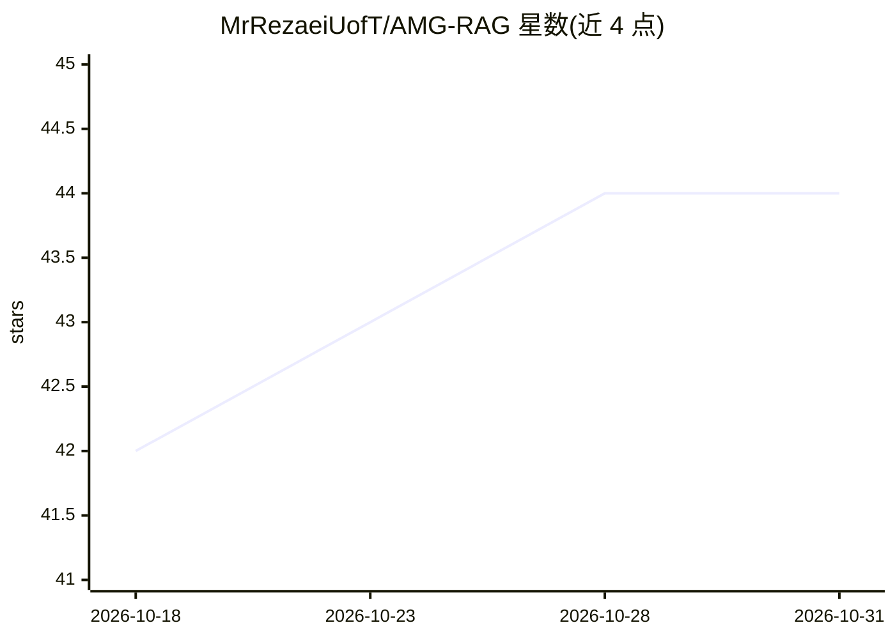

# MrRezaeiUofT/AMG-RAG

⭐ 44 · Python · NOASSERTION · 推送 2026-10-07 · [GitHub](https://github.com/MrRezaeiUofT/AMG-RAG) · [官网](https://arxiv.org/abs/2502.13010) · 组织维护

**医学 Graph-RAG 框架：自动构建医学知识图谱并回答医学问题**

面向医学问答的 Graph-RAG 框架，自动构建并持续更新医学知识图谱：含置信度打分的实体抽取、双向关系分析、多源证据检索（PubMed、Wikipedia、向量库）、思维链推理与答案生成。支持 OpenAI API 或本地 Ollama 推理，需 Python 3.8+，通过 git clone 源码安装并配置 .env。基于 LangChain/LangGraph 构建，在 MEDQA、MEDMCQA 基准上评估，附论文与 Demo。

## 筛选速览

| 维度 | 判定 | 备注 |
|---|---|---|
| AI 角色 | `ai-native` | 本体是模型或模型工具 |
| 许可风险 | `permissive` | NOASSERTION |
| 部署形态 | `None` |  |
| 模型依赖 | local-ok | 支持本地模型 |
| 硬件要求 | — | 无带数字的原话,不猜 |
| 安装摩擦 | `low` | 无编译、无系统依赖或容器化 |
| 成熟度 | — | 结构信号不足 |

## 能力要点

- 带置信度打分的实体抽取与双向关系分析构建医学知识图谱
- PubMed/Wikipedia/向量库多源证据检索
- 链式推理与多证据答案生成，附解释
- 支持 OpenAI 或本地 Ollama 两种推理方式

## 适用场景

- 构建可持续更新的医学知识图谱问答系统
- 在 MEDQA/MEDMCQA 类医学选择题数据上做问答
- 结合最新文献检索回答快速演化的医学问题

## 场景标签

`知识图谱` `RAG` · 领域:知识与检索

## 证据(README 行号)

> L9: **AMG-RAG (Agentic Medical Graph-RAG)** is a comprehensive framework that automates the construction and continuous 
> L63: ### 6. Final Answer Generation

## 星数曲线

2026-10-18 42 → 2026-10-31 44（+2）

---
*卡片 v1 · prompt 1.4 · 生成 2026-10-25 · 置信度 high · 依据 README sha `25e58d22ca8e` · [字段定义](../../DATASET.md)*
