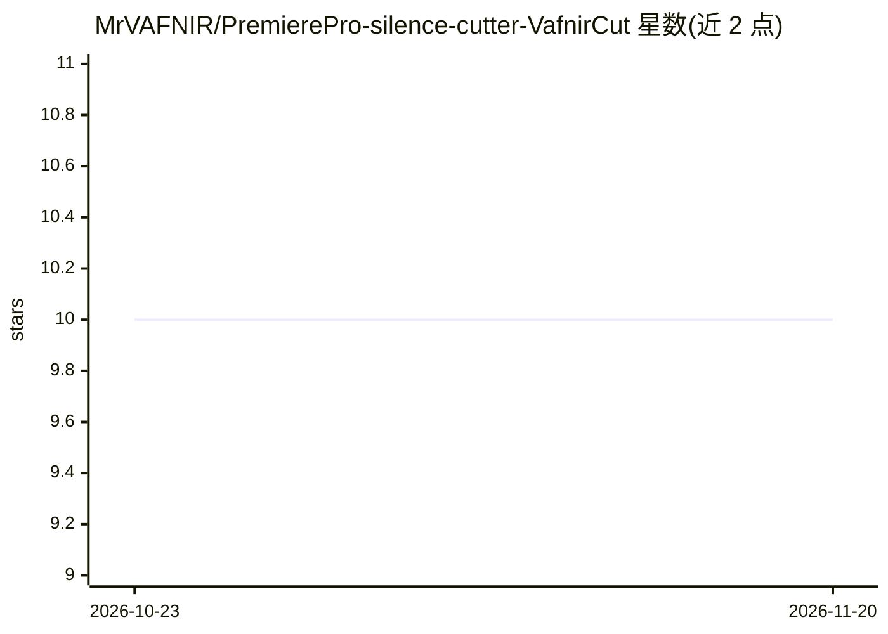

# MrVAFNIR/PremierePro-silence-cutter-VafnirCut

⭐ 10 · JavaScript · 推送 2026-09-17 · [GitHub](https://github.com/MrVAFNIR/PremierePro-silence-cutter-VafnirCut) · 个人维护

**Premiere Pro 静音自动剪除插件，一键在时间线上删除静音**

Adobe Premiere Pro 的 CEP 扩展插件，调用 auto-editor 神经网络自动检测视频/音频轨中的静音与重呼吸段，并在活动时间线上实时放置入出点、执行剪切或波纹删除。支持选择 A1-A5 多条音轨分析，提供 Margin、噪声阈值滑块调节。Windows 下通过 .exe 安装器自动下载 Python 并配置神经网络环境；安装后需手动为 Timeline/Lift 分配快捷键以启用实时剪切。仅支持 Windows 10/11 与 Premiere Pro CC 2020 及以上。

## 筛选速览

| 维度 | 判定 | 备注 |
|---|---|---|
| AI 角色 | `ai-native` | 本体是模型或模型工具 |
| 许可风险 | `none` | — |
| 部署形态 | `desktop` | 安装包/桌面程序 |
| 模型依赖 | — | README 未给出锁定关系 |
| 硬件要求 | — | 无带数字的原话,不猜 |
| 安装摩擦 | `low` | 无编译、无系统依赖或容器化 |
| 成熟度 | — | 结构信号不足 |

## 能力要点

- 基于 auto-editor 神经网络的静音与重呼吸检测
- Sniper Bot 在活动时间线上实时放置入出点并删除静音
- A1-A5 多音轨选择与 Margin/噪声阈值精调
- .exe 安装器自动配置 Python 与神经网络环境

## 适用场景

- 剪辑访谈、口播视频时批量去除静音段
- 替代手动粗剪和导出 XML 重新导入的流程
- 直播/录屏素材的快速波纹删除整理

## 场景标签

`图像视频处理` · 领域:感知与多模态

## 证据(README 行号)

> L9: **VafnirCut** is a free and stylish extension for Adobe Premiere Pro that automatically cuts out silence and heavy b
> L17: * ⚡ **Live "Sniper Bot" Cutting:** Watch the plugin magically place In/Out points and delete silence right on your 

## 星数曲线

2026-10-23 10 → 2026-11-20 10（+0）

---
*卡片 v1 · prompt 1.4 · 生成 2026-11-20 · 置信度 high · 依据 README sha `95ce25b15a82` · [字段定义](../../DATASET.md)*
