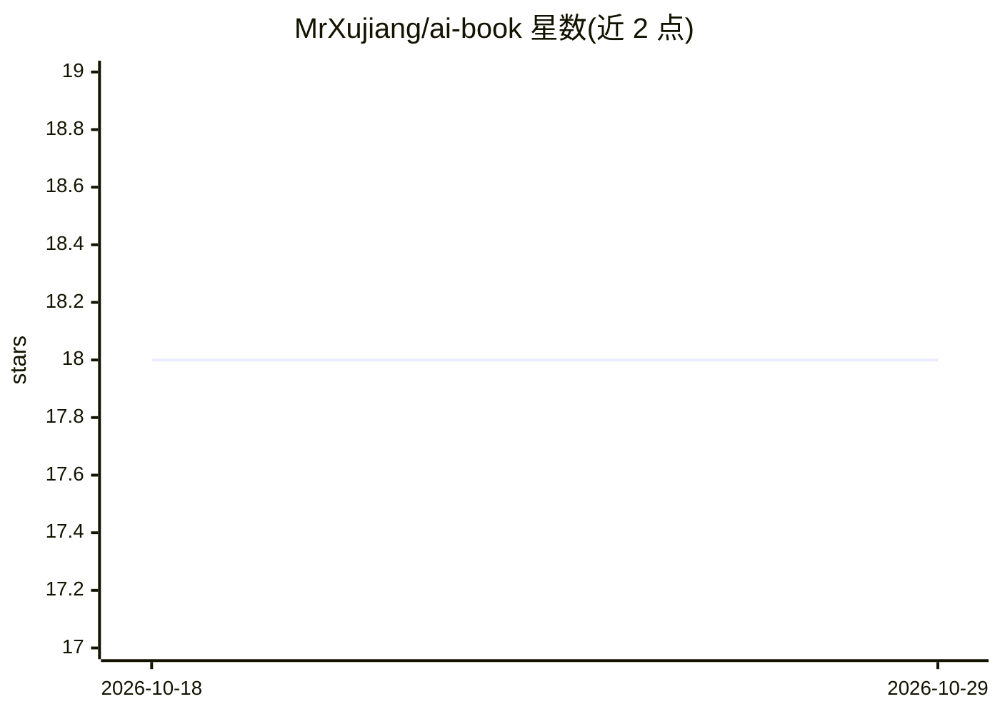

# MrXujiang/ai-book

⭐ 18 · GPL-3.0 · 推送 2026-06-05 · [GitHub](https://github.com/MrXujiang/ai-book) · [官网](https://aibook.mvtable.com) · 组织维护 · 中文 README

**付费 AI 全栈学习手册：教程+实战项目+变现路径**

趣谈AI 公众号出品的付费知识手册（Pro ¥49.9 / Plus ¥399 买断制），面向开发者、产品经理与 AI 创业者。内容组织为 18 大模块、60+ 章节，覆盖 Prompt/RAG/Agent/微调/多模态技术栈、独创 Skills+CLI+Harness 三层架构方法论、5 个含源码的 Node.js 实战项目、AI 变现与求职面试专题。购买后通过在线地址+访问密钥阅读，Plus 版含 GitHub 私仓源码与答疑社群。

## 筛选速览

| 维度 | 判定 | 备注 |
|---|---|---|
| AI 角色 | `ai-knowledge` | 知识聚合/清单类 |
| 许可风险 | `viral` | GPL-3.0 |
| 部署形态 | `None` |  |
| 模型依赖 | — | README 未给出锁定关系 |
| 硬件要求 | — | 无带数字的原话,不猜 |
| 安装摩擦 | `low` | 无编译、无系统依赖或容器化 |
| 成熟度 | — | 结构信号不足 |

## 能力要点

- 18 大模块、60+ 章节覆盖技术栈选型/最佳实践/工程化/变现/求职
- 5 个含完整可运行源码的实战项目（Plus 版专属）
- Skills+CLI+Harness 三层架构方法论与 3 天实战清单
- 30 个面试高频题与 30+ Prompt 模板库

## 适用场景

- 零基础或在职开发者系统学习 2026 年 AI 全栈技术
- 想做 AI 副业接单或独立产品的人获取变现路径与报价模板
- 求职者准备 AI 工程师面试与简历撰写

## 场景标签

`教程课程` · 领域:学习与行业

## 证据(README 行号)

> L3: **趣谈AI公众号出品 · 付费精品小册 · 持续更新**
> L17: 面向 **开发者 · 产品经理 · AI创业者**，覆盖2026年最新主流技术栈、行业最佳实践、避坑指南与5个可落地实战项目。
> L266: ## 💰 购买方案

## 星数曲线

2026-10-18 18 → 2026-10-29 18（+0）

---
*卡片 v1 · prompt 1.4 · 生成 2026-10-29 · 置信度 high · 依据 README sha `e710b7804b6f` · [字段定义](../../DATASET.md)*
