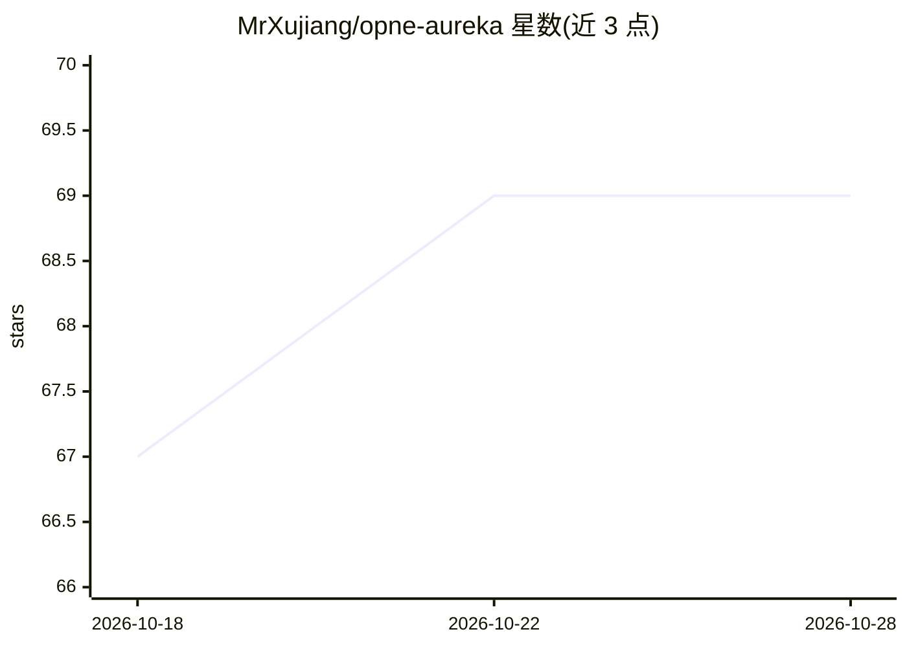

# MrXujiang/opne-aureka

⭐ 69 · TypeScript · GPL-3.0 · 推送 2026-08-03 · [GitHub](https://github.com/MrXujiang/opne-aureka) · [官网](http://aureka.jitword.com) · 个人维护 · 中文 README

**对话式 Chat BI 平台：上传表格自然语言分析生成图表报告**

开源对话式智能数据分析平台（Chat BI）：用户上传 Excel/CSV 数据集后，用自然语言提问，AI Agent 完成意图识别、SQL 生成、DuckDB 查询、数据分析与图表推荐，实时流式输出结论、表格与 ECharts 图表，并可沉淀为分析报告。面向无编程背景的数据分析用户，数据本地存储（SQLite + DuckDB），支持私有化部署。兼容 OpenAI / DeepSeek / 通义千问 / Kimi 等 LLM Provider 可切换。限制：多表 JOIN、数据库直连、报告导出、Docker 部署仍在 Roadmap 未实现。需 Node.js 20+ 与 pnpm 9+ 从源码启动，并需配置 LLM API Key。

## 筛选速览

| 维度 | 判定 | 备注 |
|---|---|---|
| AI 角色 | `ai-native` | 本体是模型或模型工具 |
| 许可风险 | `viral` | GPL-3.0 |
| 部署形态 | `library` | 以包/库形式分发 |
| 模型依赖 | locked-api |  |
| 硬件要求 | — | 无带数字的原话,不猜 |
| 安装摩擦 | `low` | 无编译、无系统依赖或容器化 |
| 成熟度 | — | 结构信号不足 |

## 能力要点

- 自然语言查询自动翻译为 SQL，经 DuckDB 执行查询
- 内置多意图路由：对比分析、归因分析、异常检测、趋势预测等
- 根据查询结果自动推荐图表类型生成 ECharts 可视化
- 兼容 OpenAI / DeepSeek / 通义千问 / Kimi 多 LLM 可切换

## 适用场景

- 上传销售表后用聊天提问对比各渠道业绩
- 无编程背景的业务人员自助做数据分析
- 将分析结论保存为报告供团队回顾

## 场景标签

`数据分析` · 领域:效率与自动化

## 证据(README 行号)

> L39: 3. 🤖 AI Agent 自动完成 **意图识别 → SQL 生成 → DuckDB 查询 → 数据分析 → 图表推荐**
> L47: - 🗣 **自然语言查询**：像聊天一样提问，自动翻译为可执行 SQL

## 星数曲线

2026-10-18 67 → 2026-10-28 69（+2）

---
*卡片 v1 · prompt 1.4 · 生成 2026-10-24 · 置信度 high · 依据 README sha `2490c97f5077` · [字段定义](../../DATASET.md)*
