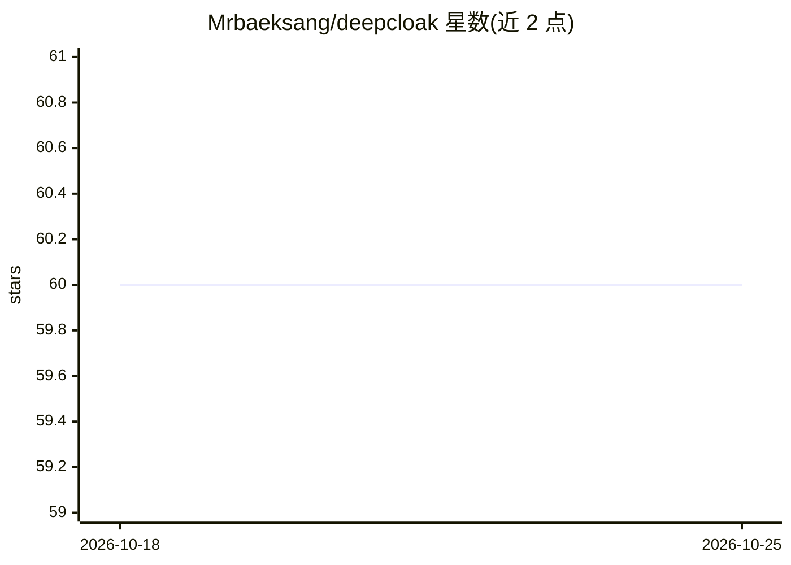

# Mrbaeksang/deepcloak

⭐ 60 · Python · MIT · 推送 2026-09-30 · [GitHub](https://github.com/Mrbaeksang/deepcloak) · [官网](https://deepcloak.vercel.app) · 个人维护 · 中文 README

**本地优先的深度研究 CLI：遇反爬墙时升级浏览器抓取并出引用报告**

DeepCloak 是封装 local-deep-research 与 CloakBrowser 的本地优先研究编排工具，以 CLI、MCP server 和 Claude skill 三种形式使用。机制：先做普通抓取，检测到 Cloudflare/Datadome/Turnstile/reCAPTCHA 等 Bot Wall 时，仅对该 URL 升级为隐身浏览器抓取并绕过，报告末尾输出绕过数量与 Evidence Record（JSON sidecar）。LLM 可选 OpenAI/Anthropic/Gemini/OpenRouter API key 或 ollama/lmstudio/llamacpp 本地后端；搜索默认 DuckDongGo，可选 SearXNG。默认忽略 robots.txt，可用 --respect-robots 开启；作者声明用户需自行承担访问合法性。

## 筛选速览

| 维度 | 判定 | 备注 |
|---|---|---|
| AI 角色 | `ai-native` | 本体是模型或模型工具 |
| 许可风险 | `permissive` | MIT |
| 部署形态 | `library` | 以包/库形式分发 |
| 模型依赖 | local-ok | 支持本地模型 |
| 硬件要求 | — | 无带数字的原话,不猜 |
| 安装摩擦 | `medium` | 含编译或系统依赖之一 |
| 成熟度 | — | 结构信号不足 |

## 能力要点

- 普通抓取失败时按 URL 逐个升级为隐身浏览器抓取，绕过 Cloudflare/Turnstile 等反爬墙
- 报告附 Evidence Record（report.md.evidence.json）与绕过来源统计
- CLI / MCP server（deep_research、get_evidence 等工具）/ Claude skill 三种接口
- 无 API key 可运行：支持 ollama/lmstudio/llamacpp 本地 LLM 后端

## 适用场景

- 研究问题需要引用被反爬墙挡住的高质量来源时补全报告
- 把 deep_research 能力接入 Claude Code/Codex 等 MCP 客户端
- 本地 LLM + SearXNG 的无 API key 深度研究流程

## 场景标签

`网页抓取` `科研工具` · 领域:效率与自动化

## 证据(README 行号)

> L5: A CLI and MCP wrapper around local-deep-research and CloakBrowser. It retries selected failed fetches in a browser a
> L58: deepcloak "How does Cloudflare Turnstile detect bots?" --depth detailed --out report.md

## 星数曲线

2026-10-18 60 → 2026-10-25 60（+0）

---
*卡片 v1 · prompt 1.4 · 生成 2026-10-24 · 置信度 high · 依据 README sha `427ebe3c9faf` · [字段定义](../../DATASET.md)*
