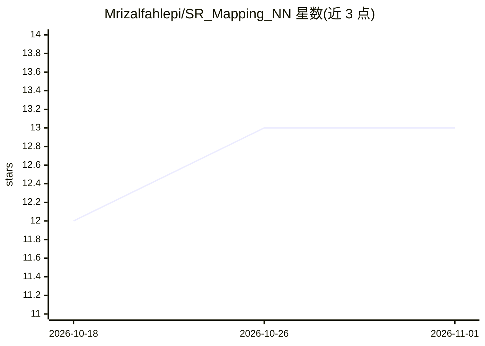

# Mrizalfahlepi/SR_Mapping_NN

⭐ 13 · Python · NOASSERTION · 推送 2026-03-25 · [GitHub](https://github.com/Mrizalfahlepi/SR_Mapping_NN) · 个人维护

**用 XGBoost 分类器过滤 XAUUSD 交易入场信号的 ML 项目**

面向 MetaTrader 5 EA 的机器学习过滤器项目：以 XGBoost 训练分类器，基于 26 个特征（RSI、ATR、支撑/阻力距离等）判断入场信号质量，替代原 EA 的网格/马丁格尔风控，每笔交易带独立 SL/TP。流程含 7 步流水线：yfinance 下载黄金期货数据、特征工程、TP/SL 模拟标注、训练、导出 ONNX（1.6 KB）供 MQL5 EA 调用、生成图表与资金曲线模拟。README 自述数据来源为黄金期货非 XAUUSD 现货、AUC 0.538、召回率 6.8%，要求实盘前回测与模拟盘验证。

## 筛选速览

| 维度 | 判定 | 备注 |
|---|---|---|
| AI 角色 | `ai-native` | 本体是模型或模型工具 |
| 许可风险 | `none` | NOASSERTION |
| 部署形态 | `None` |  |
| 模型依赖 | — | README 未给出锁定关系 |
| 硬件要求 | — | 无带数字的原话,不猜 |
| 安装摩擦 | `low` | 无编译、无系统依赖或容器化 |
| 成熟度 | `idea` | |

## 能力要点

- XGBoost 分类器基于 26 个技术特征过滤入场信号
- 模型经 ONNX 导出后在 MetaTrader 5 EA 内运行
- 7 步流水线覆盖数据下载到验证的完整流程
- 支持用自有经纪商数据重训模型

## 适用场景

- 为 XAUUSD 的 MT5 EA 添加机器学习入场过滤
- 用自有行情数据重训并回测入场分类模型
- 研究用 ML 分类器替代网格/马丁格尔风控的方案

## 场景标签

`金融量化` · 领域:学习与行业

## 证据(README 行号)

> L24: Building an **XGBoost classifier** that learns from market patterns to filter entries:
> L130: #### STEP 5: ONNX Export (`scripts/05_export_onnx.py`)

## 星数曲线

2026-10-18 12 → 2026-11-01 13（+1）

---
*卡片 v1 · prompt 1.4 · 生成 2026-10-31 · 置信度 high · 依据 README sha `ac7693dfa00b` · [字段定义](../../DATASET.md)*
