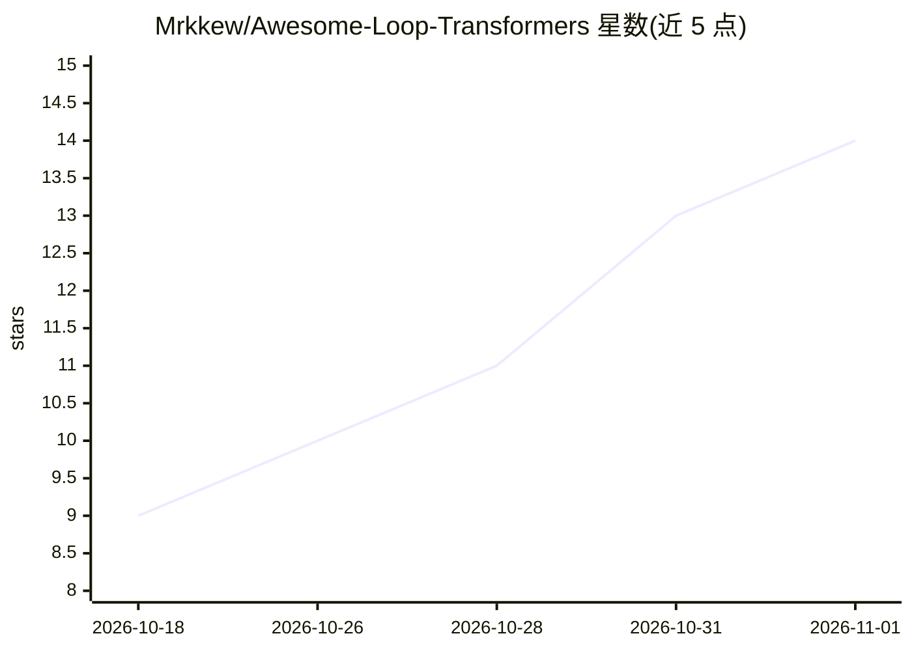

# Mrkkew/Awesome-Loop-Transformers

⭐ 14 · TypeScript · NOASSERTION · 推送 2026-10-27 · [GitHub](https://github.com/Mrkkew/Awesome-Loop-Transformers) · [官网](https://awesome-loop-transformers.bright-haven-2369.chatgpt.site) · 个人维护 · 中文 README

**循环 Transformer 论文研究图谱：247 篇论文的双语阅读指南**

面向循环/递归 Transformer、潜在推理与测试时计算研究方向的论文策展清单（awesome list），收录 247 篇论文，按 Foundations & Theory、Architectures & Scaling、Latent Reasoning、Adaptive Compute 等 8 个研究主题组织。每条目含研究问题摘要并链接官方论文与代码，提供英/简中双语内容、交互式目录检索与 JSON 目录数据。定位为阅读选编而非排名，持续更新。

## 筛选速览

| 维度 | 判定 | 备注 |
|---|---|---|
| AI 角色 | `ai-knowledge` | 知识聚合/清单类 |
| 许可风险 | `none` | NOASSERTION |
| 部署形态 | `None` |  |
| 模型依赖 | — | README 未给出锁定关系 |
| 硬件要求 | — | 无带数字的原话,不猜 |
| 安装摩擦 | `medium` | 含编译或系统依赖之一 |
| 成熟度 | — | 结构信号不足 |

## 能力要点

- 247 篇论文按 8 个研究主题组织，条目附研究问题摘要
- 核心轨道 199 篇 + 更广潜在推理 43 篇（2024 年后 242 篇）
- 英/简中双语内容，附交互式目录与 JSON 目录数据
- 每条目链接原始论文与官方代码

## 适用场景

- 系统性梳理 looped Transformer 与潜在推理方向的研究脉络
- 按主题和年份查找相关论文及官方代码
- 快速了解 Universal Transformers、Huginn、Ouro 等代表工作

## 场景标签

`精选清单` · 领域:学习与行业

## 证据(README 行号)

> L7:  Looped Transformers, latent reasoning, and test-time compute. A bilingual reading guide with papers, official code,
> L15:  247 papers · 8 research topics · English / 简体中文 · Last research update: 2026-10-27

## 星数曲线

2026-10-18 9 → 2026-11-01 14（+5）

---
*卡片 v1 · prompt 1.4 · 生成 2026-10-31 · 置信度 high · 依据 README sha `e87822c3bfdd` · [字段定义](../../DATASET.md)*
