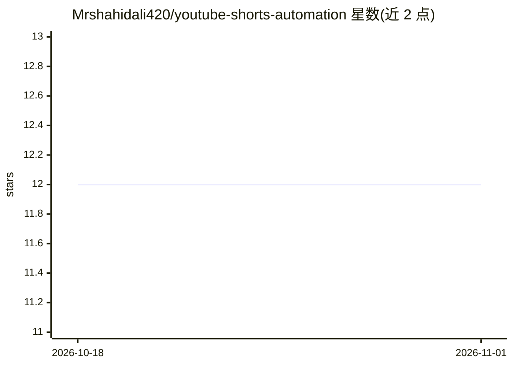

# Mrshahidali420/youtube-shorts-automation

⭐ 12 · Python · MIT · 推送 2026-09-14 · [GitHub](https://github.com/Mrshahidali420/youtube-shorts-automation) · [官网](https://www.shahidali.co/) · 个人维护

**用 Gemini AI 优化元数据与排错的 YouTube Shorts 自动化脚本套件**

由四个 Python 脚本组成的 YouTube Shorts 自动化流水线：按关键词或指定频道发现并下载视频（yt_dlp）、调用 Google Gemini 生成 SEO 标题/描述/标签并建议分类、通过 Selenium 驱动 Firefox 上传、按 YouTube Analytics 高峰时段调度发布，并用 Excel 记录下载/上传数据与表现指标。自改进机制包括基于表现的 keyword 评分、元数据提示词优化与 AI 辅助错误分析。需 Python 3.10+、Firefox、FFmpeg 和 Gemini API key。

## 筛选速览

| 维度 | 判定 | 备注 |
|---|---|---|
| AI 角色 | `ai-enhanced` | 去掉 AI 部分产品仍成立 |
| 许可风险 | `permissive` | MIT |
| 部署形态 | `library` | 以包/库形式分发 |
| 模型依赖 | — | README 未给出锁定关系 |
| 硬件要求 | — | 无带数字的原话,不猜 |
| 安装摩擦 | `low` | 无编译、无系统依赖或容器化 |
| 成熟度 | — | 结构信号不足 |

## 能力要点

- 关键词/频道两种下载模式，含 SEO 元数据生成与分类建议
- 基于 YouTube Analytics 高峰时段的自动调度发布
- 表现反馈循环：keyword 评分、提示词自动优化、参数调优建议
- Gemini AI 辅助错误模式分析与优化建议

## 适用场景

- 批量下载并二次发布指定关键词或频道的 Shorts
- 让 AI 生成 SEO 优化的标题、描述和标签
- 按观众高峰时段自动排期上传并跟踪表现

## 场景标签

`浏览器自动化` · 领域:效率与自动化

## 证据(README 行号)

> L6: This suite of scripts automates the entire YouTube Shorts workflow - from finding videos to tracking performance. It
> L45: - **AI-Assisted Analysis**: Use Google's Gemini AI to analyze errors and suggest improvements

## 星数曲线

2026-10-18 12 → 2026-11-01 12（+0）

---
*卡片 v1 · prompt 1.4 · 生成 2026-11-01 · 置信度 high · 依据 README sha `e4eafb2cea6e` · [字段定义](../../DATASET.md)*
