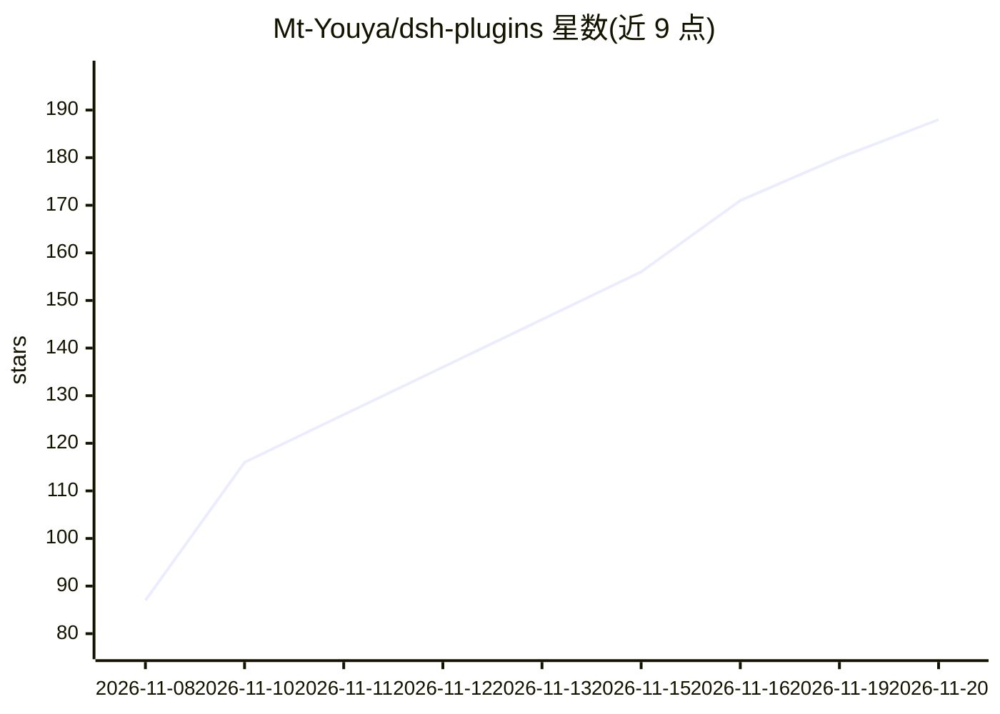

# Mt-Youya/dsh-plugins

⭐ 188 · TypeScript · MIT · 推送 2026-11-16 · [GitHub](https://github.com/Mt-Youya/dsh-plugins) · [官网](https://npmjs.com/package/@cyrusdoyle/dsh-plugins) · 个人维护 · 中文 README

**DeepSeek Harness 的会话洞察插件集合，查看每轮喂给模型的内容**

面向 DeepSeek Harness（DSH，0.2.1-rc.5+）的插件集合，可整包安装或单独安装成员。当前成员 Sessions Insight 展示 Claude Code、DSH 或 Codex 每轮会话实际喂给模型的构成：输入组成、工具调用、压缩与费用，并支持确认后的会话删除与 handoff。设置由 Host 保存；余额与版本检查默认关闭，开启后仅访问两个固定 HTTPS 端点，密钥不存储不记录。以 pnpm monorepo 组织，通过 dsh plugin 命令或插件管理器从 npm 安装。

## 筛选速览

| 维度 | 判定 | 备注 |
|---|---|---|
| AI 角色 | `ai-ecosystem` | LLM/agent 周边工具 |
| 许可风险 | `permissive` | MIT |
| 部署形态 | `library` | 以包/库形式分发 |
| 模型依赖 | locked-api |  |
| 硬件要求 | — | 无带数字的原话,不猜 |
| 安装摩擦 | `low` | 无编译、无系统依赖或容器化 |
| 成熟度 | — | 结构信号不足 |

## 能力要点

- Sessions Insight 展示每轮会话的输入构成、工具调用、压缩与费用
- 余额/版本检查默认关闭，出站流量限定两个固定 HTTPS 端点，密钥不存储
- 支持整包安装与单插件安装（npm 或本地目录）
- pnpm monorepo，集合与成员共享版本号一起发布

## 适用场景

- 查看 AI 编码会话中每轮实际发送给模型的内容与开销
- 确认后清理本地会话记录
- 将现有 DSH 会话通过 handoff 移交到新会话

## 场景标签

 · 领域:AI 开发者工具/插件

## 证据(README 行号)

> L5: A plugin collection for DeepSeek Harness (DSH). Install this one bundle to get every plugin listed below; each plugi
> L14: |Sessions Insight|`@cyrusdoyle/dsh-sessions-insight`|Opens up what each turn of a Claude Code, DSH or Codex session

## 星数曲线

2026-11-08 87 → 2026-11-20 188（+101）

---
*卡片 v1 · prompt 1.4 · 生成 2026-11-18 · 置信度 high · 依据 README sha `d286c66424ca` · [字段定义](../../DATASET.md)*
