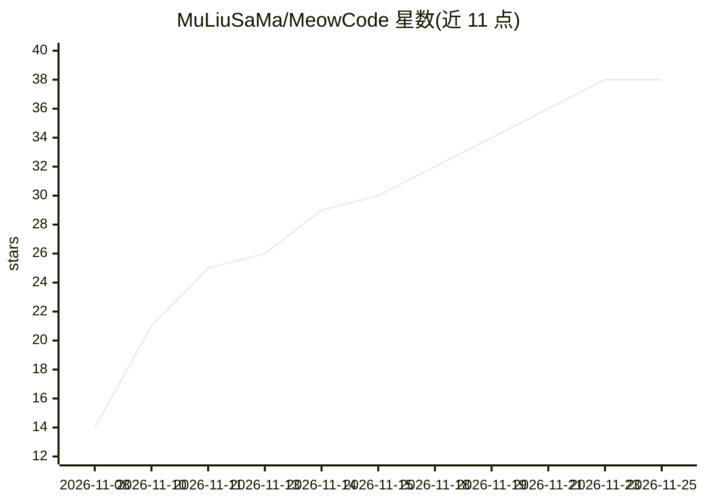

# MuLiuSaMa/MeowCode

⭐ 38 · TypeScript · GPL-3.0 · 推送 2026-11-22 · [GitHub](https://github.com/MuLiuSaMa/MeowCode) · [官网](https://meowcode.cn) · 个人维护 · 中文 README

**架构可自由修改的本地编程 Agent 桌面应用**

基于 Electron + React 的桌面端编程 Agent，Agent 内核运行在本地 HTTP/SSE 服务中，UI 与内核仅通过事件流通信，内核可单独运行、替换或重写。功能覆盖多服务商模型接入（Anthropic/OpenAI 协议）、文件/命令/浏览器/电脑控制工具与四档审批、13 种角色的多 Agent 分层编排（编排写入 harness.json 改完即生效）、Token 三层治理、内置终端/Git/邮件客户端、插件与技能市场、实验性自我学习，以及从 Qoder/opencode/Codex 等导入数据。需 Windows 10/11 x64、Node.js 20+ 与 pnpm，从源码构建运行。

## 筛选速览

| 维度 | 判定 | 备注 |
|---|---|---|
| AI 角色 | `ai-native` | 本体是模型或模型工具 |
| 许可风险 | `viral` | GPL-3.0 |
| 部署形态 | `desktop` | 安装包/桌面程序 |
| 模型依赖 | locked-api |  |
| 硬件要求 | — | 无带数字的原话,不猜 |
| 安装摩擦 | `low` | 无编译、无系统依赖或容器化 |
| 成熟度 | `idea` | |

## 能力要点

- 内核与界面解耦，pnpm dev:server 可脱离桌面端单独运行 agent 服务
- 编排即配置：角色/层级/门禁/工具白名单写入 harness.json，保存即生效
- 13 种内置角色的 T0/T1/T2 分层编排，lane 可并行推进
- 自我学习（实验性，默认关闭）：回合经验沉淀为本地 Markdown/JSON 制品，带试用期与回滚

## 适用场景

- 在本地桌面应用中让 Agent 完成编程任务并逐项审批写操作
- 按项目需要自定义多 Agent 编排架构与门禁规则
- 在单窗口内同时使用终端、浏览器、Git 与邮件客户端

## 场景标签

`编码 Agent` `多智能体` · 领域:Agent 开发

## 证据(README 行号)

> L13: 一个**架构可以随你改**的本地编程 Agent 桌面应用。
> L15: Electron + React 负责界面，Agent 内核跑在本地 HTTP/SSE 服务里，UI 与内核只通过事件流通信——所以内核可以单独跑、单独换、单独重写，不会牵动界面。
> L20: - **不是黑盒**：工具调用、审批、压缩、缓存策略全是 `src/agent/` 里的普通 TypeScript，改完即生效，没有打包魔法。

## 星数曲线

2026-11-08 14 → 2026-11-25 38（+24）

---
*卡片 v1 · prompt 1.4 · 生成 2026-11-18 · 置信度 high · 依据 README sha `f14797682def` · [字段定义](../../DATASET.md)*
