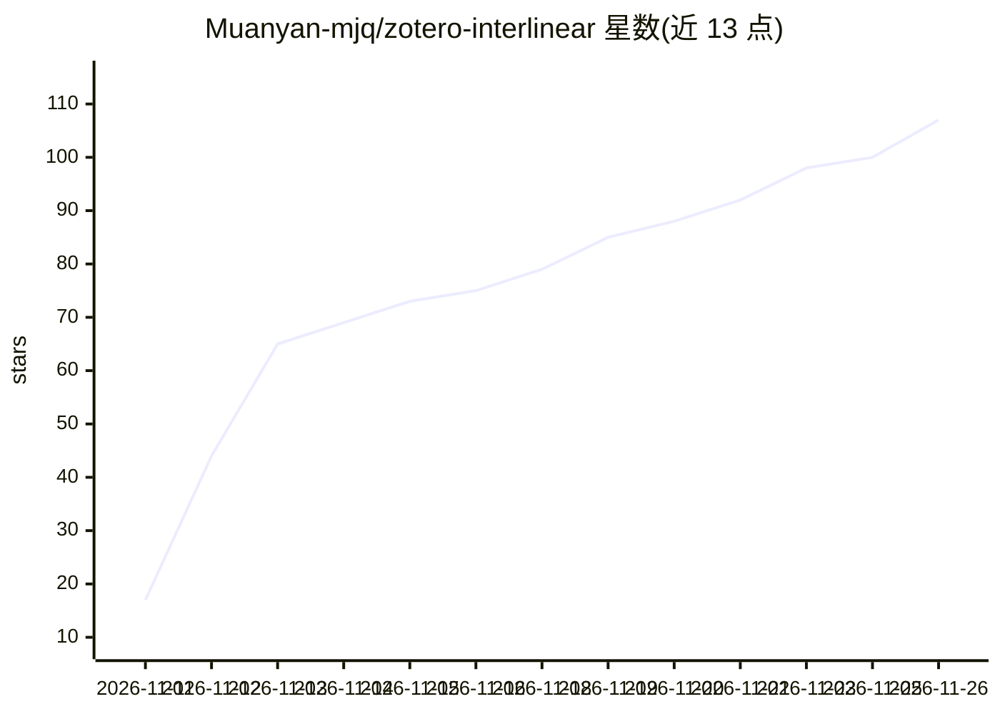

# Muanyan-mjq/zotero-interlinear

⭐ 107 · TypeScript · AGPL-3.0 · 推送 2026-11-19 · [GitHub](https://github.com/Muanyan-mjq/zotero-interlinear) · 个人维护 · 中文 README

**Zotero 10/11 段落对照翻译插件：原文下方即显示译文**

嵌入 Zotero 桌面 PDF 阅读模式的翻译插件：对每个结构化段落获取译文并渲染在原文下方，支持四种布局。内置五个翻译服务（免 key 的 Google 配额池轮换、Edge、MyMemory、自托管 LibreTranslate，以及阿里云/Azure 免费额度），并支持 OpenAI 兼容端点、Claude、Gemini 与 Ollama。提供术语表注入 LLM 提示词、LLM 阅读助手侧边栏、双语 PDF 导出、按服务/语言对/术语表缓存。翻译段落文本会发送到所配置的服务，API key 经 OS 密钥库加密存储。以 .xpi 安装包形式安装，需重启 Zotero。

## 筛选速览

| 维度 | 判定 | 备注 |
|---|---|---|
| AI 角色 | `ai-native` | 本体是模型或模型工具 |
| 许可风险 | `viral` | AGPL-3.0 |
| 部署形态 | `desktop` | 安装包/桌面程序 |
| 模型依赖 | local-ok | 支持本地模型 |
| 硬件要求 | — | 无带数字的原话,不猜 |
| 安装摩擦 | `low` | 无编译、无系统依赖或容器化 |
| 成熟度 | — | 结构信号不足 |

## 能力要点

- 每段原文下方渲染译文，四种布局（对照/分栏/仅译文/仅原文）
- 五种内置翻译服务 + OpenAI 兼容/Claude/Gemini/Ollama 后端
- 术语表 CSV/TSV 导入导出，注入 LLM 提示词并对所有服务做译后强制替换
- LLM 阅读助手聊天侧边栏与双语 PDF 导出

## 适用场景

- 在 Zotero 里直接阅读外文论文，无需复制粘贴到翻译器
- 用自己的 Ollama 本地模型翻译敏感文档
- 维护术语表保证专业文献翻译用词一致

## 场景标签

`文档问答` · 领域:知识与检索

## 证据(README 行号)

> L5: Read foreign-language papers in Zotero 10 with a translation under every paragraph.
> L13: - **Five built-in translation services.** Free Google Translate works out of the box with no API key (rotating seve

## 星数曲线

2026-11-11 17 → 2026-11-26 107（+90）

---
*卡片 v1 · prompt 1.4 · 生成 2026-11-18 · 置信度 mid · 依据 README sha `ab64f3e650fa` · [字段定义](../../DATASET.md)*
