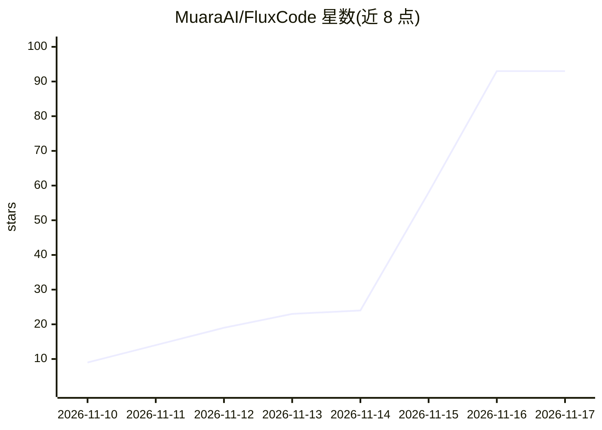

# MuaraAI/FluxCode

⭐ 93 · Rust · GPL-3.0 · 推送 2026-11-16 · [GitHub](https://github.com/MuaraAI/FluxCode) · [官网](https://fluxcode.muaraai.com) · 组织维护

**Rust 编写的轻量原生代码编辑器，内置 AI agent 面板**

用 Rust 和 GPUI（Zed 所用框架）编写的跨平台代码编辑器，单进程 GPU 渲染，基准测试中窗口约 50 ms 打开、空闲内存 1.4 MB。内置通过 Agent Client Protocol 接入的 AI agent 面板（可从 ACP 注册表列出并一键安装 agent）、GitHub Copilot 行内补全、Python 友好终端、内置 git 源码管理、实时协作、以及对二进制/PDF/Office/ZIP/SQLite 文件的只读查看。自称仍在开发中：暂无调试器、扩展和语言服务器；无遥测。提供 Windows/macOS/Linux 安装包。

## 筛选速览

| 维度 | 判定 | 备注 |
|---|---|---|
| AI 角色 | `ai-enhanced` | 去掉 AI 部分产品仍成立 |
| 许可风险 | `viral` | GPL-3.0 |
| 部署形态 | `desktop` | 安装包/桌面程序 |
| 模型依赖 | — | README 未给出锁定关系 |
| 硬件要求 | — | 无带数字的原话,不猜 |
| 安装摩擦 | `medium` | 含编译或系统依赖之一 |
| 成熟度 | `idea` | |

## 能力要点

- AI agent 面板通过 ACP 协议接入，agent 可一键安装并支持逐回合作者撤销文件改动
- GitHub Copilot 行内补全（Copilot 语言服务器作为独立进程运行）
- 二进制/PDF/Office/ZIP/SQLite 文件只读查看
- 单进程 GPU 渲染，无遥测，一键自更新

## 适用场景

- 想要一个资源占用低、启动快的代码编辑器
- 在编辑器里通过 ACP agent 让 AI 修改代码并逐回合审阅/撤销
- 直接打开数据库、PDF、Office 等文件查看内容

## 场景标签

`编码 Agent` · 领域:编码与开发

## 证据(README 行号)

> L5: A native code editor for Windows, macOS and Linux, written in Rust and drawn by the GPU.
> L155: - **Built for AI agents.** The agent panel speaks the Agent Client Protocol and lists
> L160: - **GitHub Copilot inline completions.** A moment after you stop typing, Copilot suggests

## 星数曲线

2026-11-10 9 → 2026-11-17 93（+84）

---
*卡片 v1 · prompt 1.4 · 生成 2026-11-17 · 置信度 mid · 依据 README sha `4a6d11094866` · [字段定义](../../DATASET.md)*
