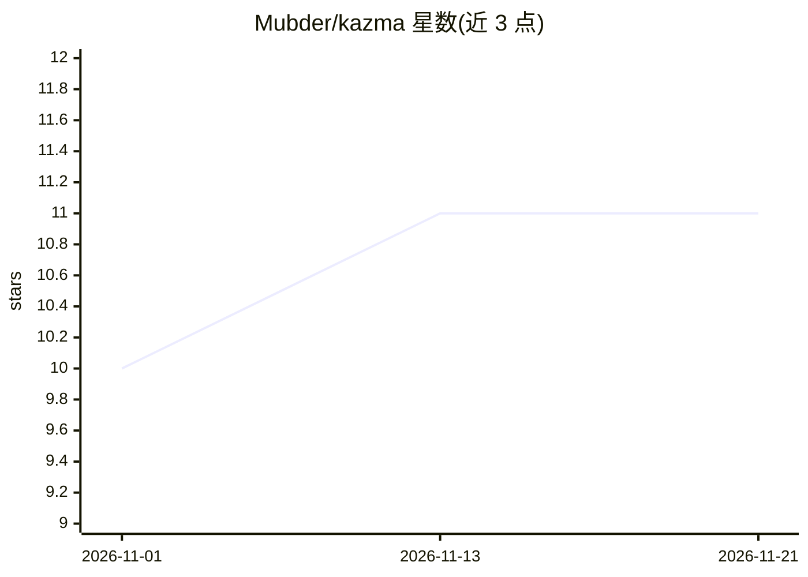

# Mubder/kazma

⭐ 11 · Python · MIT · 推送 2026-11-20 · [GitHub](https://github.com/Mubder/kazma) · [官网](https://kazma.ai/) · 个人维护

**自托管双语（英/阿）AI agent 平台，行动前请求批准**

自托管的 AI agent 平台：单个 agent 通过 Web UI、TUI、CLI、Telegram、Discord 和 Slack 多渠道接入，具备带时间与有效期属性的可视化长期记忆、风险操作前统一的批准门控、Web IDE（文件/git/代码索引/补丁回滚）、知识库与多源 Deep Research 流水线、X Studio 发布管理、六种模式的 swarm 编排及文档解析（含阿拉伯文渲染与 OCR）。MIT 许可，Python 3.11–3.14，通过 setup 脚本、Docker Compose 或源码安装。

## 筛选速览

| 维度 | 判定 | 备注 |
|---|---|---|
| AI 角色 | `ai-native` | 本体是模型或模型工具 |
| 许可风险 | `permissive` | MIT |
| 部署形态 | `desktop` | 安装包/桌面程序 |
| 模型依赖 | local-ok | 支持本地模型 |
| 硬件要求 | — | 无带数字的原话,不猜 |
| 安装摩擦 | `low` | 无编译、无系统依赖或容器化 |
| 成熟度 | — | 结构信号不足 |

## 能力要点

- 风险操作前批准：统一批准注册表，未分类工具默认门控
- 同一 agent 覆盖 Web/TUI/CLI/Telegram/Discord/Slack 六渠道
- 知识库与多源 Deep Research，含报告与持久任务链接
- 英文与阿拉伯文对等支持：RTL 界面、方言处理、阿拉伯文 OCR

## 适用场景

- 在自己服务器上运行一个带审批机制的 AI agent
- 从聊天软件和终端随时接续同一 agent 会话
- 让 agent 管理并发布 X 内容
- 用自建文档库做知识问答与深度研究

## 场景标签

`Agent 框架` `Agent 记忆` `多智能体` `文档解析` · 领域:Agent 开发

## 证据(README 行号)

> L5:  **The self-hosted AI agent that asks before it acts.**
> L303:     S["LangGraph supervisor plans, calls tools, answers"]

## 星数曲线

2026-11-01 10 → 2026-11-21 11（+1）

---
*卡片 v1 · prompt 1.4 · 生成 2026-11-19 · 置信度 mid · 依据 README sha `4f27ce1549f0` · [字段定义](../../DATASET.md)*
