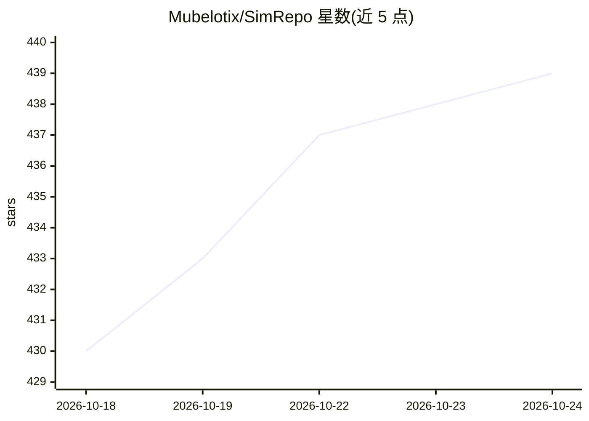

# Mubelotix/SimRepo

⭐ 439 · TypeScript · NOASSERTION · 推送 2026-10-23 · [GitHub](https://github.com/Mubelotix/SimRepo) · [官网](https://star-history.dera.page) · 个人维护

**无需 Token 的 GitHub 星图与相似仓库推荐工具（含浏览器扩展）**

面向 GitHub 用户与开源选型人群的仓库发现工具：提供无需 API token 的 star 历史图表（手绘 xkcd 风格，支持日期/时间线多图模式、一键生成图片、实时嵌入 README），并基于推荐引擎在仓库侧边栏展示相似项目以辅助选型。相似仓库功能通过支持 Firefox/Chrome/Edge 等多种浏览器的扩展实现。仓库由个人维护，接受赞助与贡献；许可按 fork 边界拆分（上游 MIT，fork 后改动 GPL-3.0）。

## 筛选速览

| 维度 | 判定 | 备注 |
|---|---|---|
| AI 角色 | `ai-enhanced` | 去掉 AI 部分产品仍成立 |
| 许可风险 | `none` | NOASSERTION |
| 部署形态 | `None` |  |
| 模型依赖 | — | README 未给出锁定关系 |
| 硬件要求 | — | 无带数字的原话,不猜 |
| 安装摩擦 | `low` | 无编译、无系统依赖或容器化 |
| 成熟度 | — | 结构信号不足 |

## 能力要点

- 星图无需 API token，支持一键生成图片与实时嵌入 README
- 推荐引擎在仓库侧边栏展示相似项目
- 浏览器扩展支持 Firefox/Brave/Chrome/Edge/Vivaldi/Opera/Tor
- 支持日期或时间线的多图模式与多仓库输入

## 适用场景

- 在多个候选开源项目中通过星图对比增长趋势
- 浏览仓库时发现相似替代项目辅助选型
- 将实时星图嵌入自己的 GitHub README

## 场景标签

 · 领域:开发者工具/开源仓库发现

## 证据(README 行号)

> L21: SimRepo enhances GitHub by showing similar projects in a repository's sidebar.
> L38: - Discover similar repositories to find the best option for your needs.

## 星数曲线

2026-10-18 430 → 2026-10-24 439（+9）

---
*卡片 v1 · prompt 1.4 · 生成 2026-10-21 · 置信度 high · 依据 README sha `998856e418f4` · [字段定义](../../DATASET.md)*
