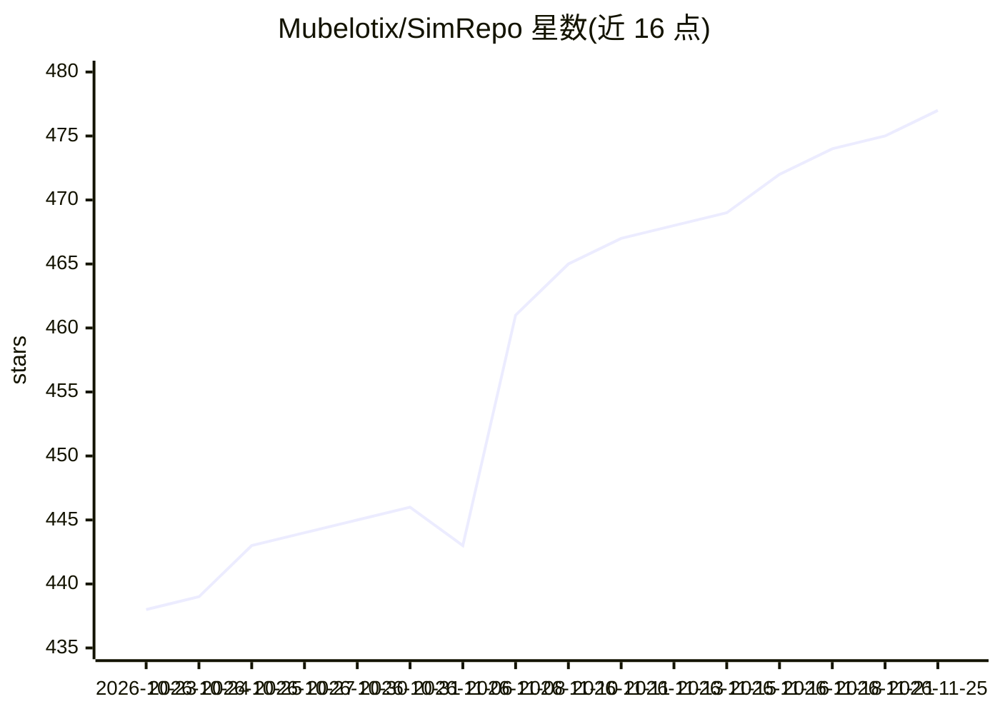

# Mubelotix/SimRepo

⭐ 477 · TypeScript · NOASSERTION · 推送 2026-11-17 · [GitHub](https://github.com/Mubelotix/SimRepo) · [官网](https://simrepo.dera.page) · 个人维护

**为开发者提供 GitHub 星标历史图表与相似仓库发现**

SimRepo 是一个 GitHub 仓库可视化与发现工具：生成星标历史图表（支持按日期/时间线多种视图、一键导出高质量图片、嵌入 README 或网页），并通过浏览器扩展在仓库侧边栏展示相似项目，帮助开发者发现可替代/相似的开源仓库。无需 API token 即可使用，支持 Firefox、Chrome、Edge 等多款浏览器。项目由 Star History 代码分叉而来，分叉点前代码为 MIT，扩展及之后的修改为 GPL-3.0。

## 筛选速览

| 维度 | 判定 | 备注 |
|---|---|---|
| AI 角色 | `ai-enhanced` | 去掉 AI 部分产品仍成立 |
| 许可风险 | `none` | NOASSERTION |
| 部署形态 | `None` |  |
| 模型依赖 | — | README 未给出锁定关系 |
| 硬件要求 | — | 无带数字的原话,不猜 |
| 安装摩擦 | `low` | 无编译、无系统依赖或容器化 |
| 成熟度 | — | 结构信号不足 |

## 能力要点

- 无需 API token 生成实时星标历史图表
- 浏览器扩展在 GitHub 仓库侧边栏展示相似项目
- 支持将图表嵌入 GitHub README 或其他网站
- 支持多种图表视图与多仓库对比输入

## 适用场景

- 给开源项目 README 嵌入实时星标历史图表
- 发现与某仓库相似的备选开源项目
- 对比多个仓库的星标增长趋势

## 场景标签

`推荐系统` · 领域:学习与行业

## 证据(README 行号)

> L5: **Token-free GitHub star charts & intelligent repository discovery**
> L21: SimRepo enhances GitHub by showing similar projects in a repository's sidebar.
> L38: - Discover similar repositories to find the best option for your needs.

## 星数曲线

2026-10-23 438 → 2026-11-25 477（+39）

---
*卡片 v1 · prompt 1.4 · 生成 2026-11-25 · 置信度 mid · 依据 README sha `de57bc623df6` · [字段定义](../../DATASET.md)*
