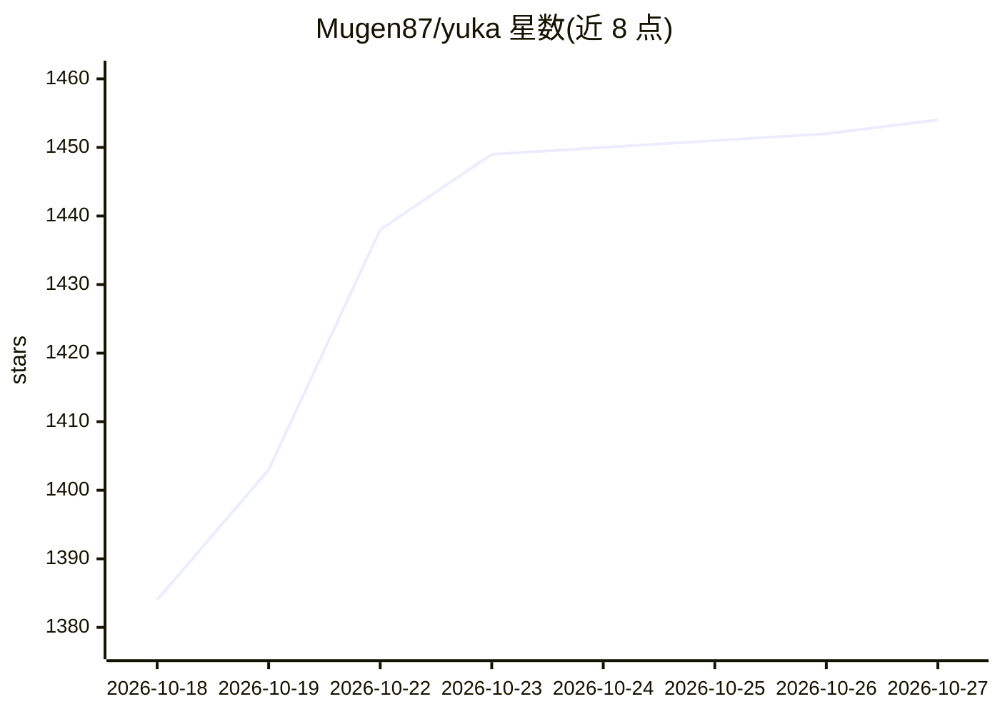

# Mugen87/yuka

⭐ 1,454 · JavaScript · MIT · 推送 2026-10-20 · [GitHub](https://github.com/Mugen87/yuka) · [官网](https://mugen87.github.io/yuka/) · 个人维护

**面向游戏 AI 开发的 JavaScript 库：自主智能体、转向、导航与模糊逻辑**

用于开发游戏 AI 的独立 JavaScript 库，不依赖特定 3D 引擎。提供游戏实体概念与状态驱动/目标驱动的智能体设计类、内置车辆模型与转向行为、图类与搜索算法及导航网格实现的寻路、带短期记忆与视觉组件的感知系统、触发器，以及模糊推理系统和基于 JSON 的状态序列化 API。通过 npm 安装使用，附文档网站与本地示例服务器，推荐配套两本游戏 AI 书籍。MIT 许可。

## 筛选速览

| 维度 | 判定 | 备注 |
|---|---|---|
| AI 角色 | `ai-ecosystem` | LLM/agent 周边工具 |
| 许可风险 | `permissive` | MIT |
| 部署形态 | `library` | 以包/库形式分发 |
| 模型依赖 | — | README 未给出锁定关系 |
| 硬件要求 | — | 无带数字的原话,不猜 |
| 安装摩擦 | `low` | 无编译、无系统依赖或容器化 |
| 成熟度 | — | 结构信号不足 |

## 能力要点

- 状态驱动与目标驱动的智能体设计类
- 转向行为、导航网格与寻路算法
- 感知系统（短期记忆与视觉组件）与模糊推理
- 引擎无关的独立库，JSON 序列化保存/加载游戏状态

## 适用场景

- 为游戏中的 NPC 构建状态机或目标驱动行为
- 实现车辆转向与导航网格寻路
- 为游戏实体添加视觉感知与模糊逻辑决策

## 场景标签

 · 领域:游戏开发/AI

## 证据(README 行号)

> L3: Yuka is a JavaScript library for developing Game AI.
> L5: * **Autonomous Agent Design:** Yuka provides a basic game entity concept and classes for state-driven and goal-drive
> L13: Yuka is a standalone library and independent of a particular 3D engine.

## 星数曲线

2026-10-18 1,384 → 2026-10-27 1,454（+70）

---
*卡片 v1 · prompt 1.4 · 生成 2026-10-21 · 置信度 mid · 依据 README sha `93f5abd54079` · [字段定义](../../DATASET.md)*
