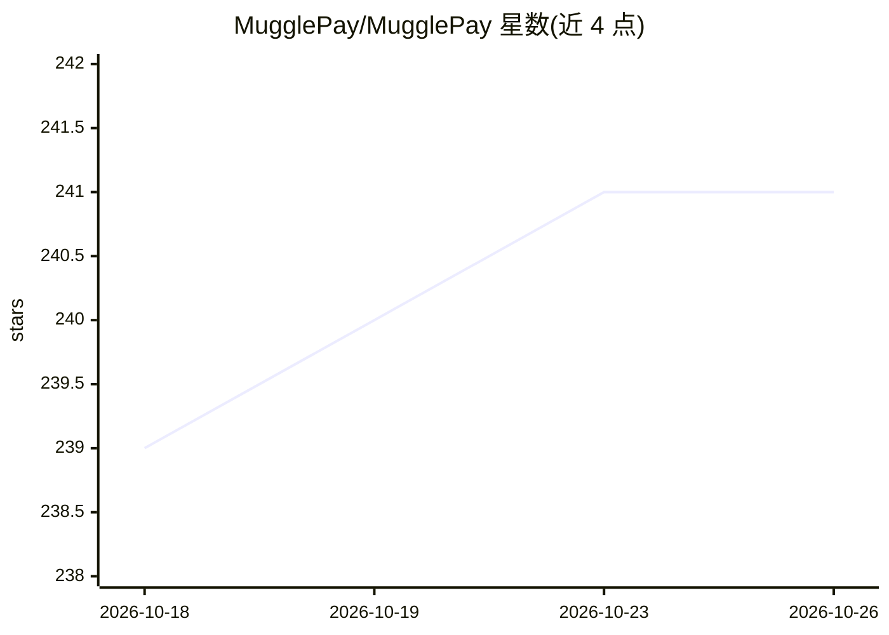

# MugglePay/MugglePay

⭐ 241 · JavaScript · BSD-2-Clause · 推送 2026-03-16 · [GitHub](https://github.com/MugglePay/MugglePay) · [官网](https://blog.mugglepay.com/) · 组织维护 · 中文 README

**面向商户与 AI Agent 的加密货币支付网关**

加密货币支付网关服务，供商户与 AI Agent 接收 BTC（含闪电网络）、ETH、USDT、BCH、LTC、EOS 等加密货币付款。提供商户门户注册、API Key 凭证生成、订单创建/查询/退款/Webhook 回调等 Merchant API，并为 Shopify、WHMCS、WHMCS8 提供购物车插件实现 5 分钟接入。仓库同时以 README 形式承担产品介绍与接入指引，BSD 许可。限制：无 SDK 安装命令细节，接入依赖注册商户门户获取凭证。

## 筛选速览

| 维度 | 判定 | 备注 |
|---|---|---|
| AI 角色 | `ai-enhanced` | 去掉 AI 部分产品仍成立 |
| 许可风险 | `permissive` | BSD-2-Clause |
| 部署形态 | `None` |  |
| 模型依赖 | — | README 未给出锁定关系 |
| 硬件要求 | — | 无带数字的原话,不猜 |
| 安装摩擦 | `low` | 无编译、无系统依赖或容器化 |
| 成熟度 | — | 结构信号不足 |

## 能力要点

- 支持 BTC/闪电网络、ETH、USDT、BCH、LTC、EOS 收款
- 提供订单创建、回调、退款、取消等全套支付 API
- Shopify / WHMCS / WHMCS8 购物车插件
- 商户门户注册并生成开发密钥与 Secret

## 适用场景

- 电商结账页接入加密货币收款
- AI Agent 场景下接受加密货币支付
- 托管商与建站平台通过 WHMCS 插件收款

## 场景标签

 · 领域:金融科技/支付

## 证据(README 行号)

> L17: Accept Cryptocurrencies now! Integrated payment gateway for cryptocurrencies such as Bitcoin and USDT.
> L22:  - Accept Cryptocurrencies: BTC, BTC (Lightning Network), ETH, USDT, BCH, LTC, EOS

## 星数曲线

2026-10-18 239 → 2026-10-26 241（+2）

---
*卡片 v1 · prompt 1.4 · 生成 2026-10-22 · 置信度 mid · 依据 README sha `1a4ce4532c46` · [字段定义](../../DATASET.md)*
