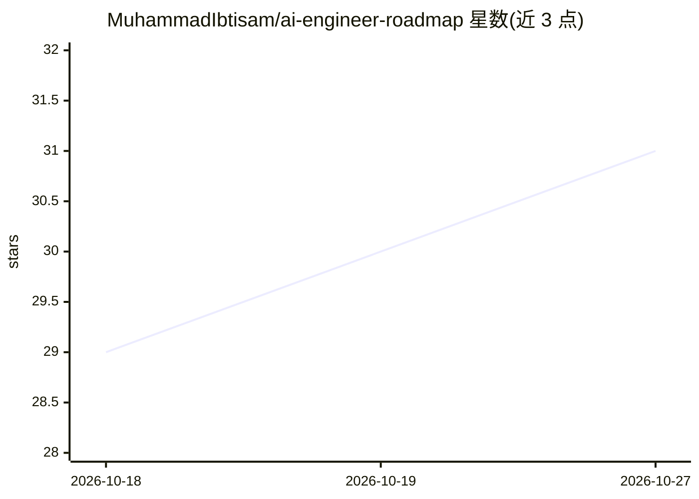

# MuhammadIbtisam/ai-engineer-roadmap

⭐ 31 · Python · MIT · 推送 2026-04-19 · [GitHub](https://github.com/MuhammadIbtisam/ai-engineer-roadmap) · 个人维护

**AI 工程师学习路线图：从 Python 基础到生产级 RAG/Agent/微调**

面向自学者与转型工程师的开源课程型路线图，按 10 个模块组织：Python/数学前置、LLM 原理、提示工程、OpenAI/Anthropic/Ollama 等 LLM API、RAG、Agent 与工具、微调（LoRA/QLoRA）、MLOps（Docker/MLflow）、生产化与面试准备，附 15 个实战项目与进度勾选清单。每个模块遵循 concepts→notebooks→exercises→mini project 的使用节奏，提供 5 条不同起点的快速路径，全流程 API 开销可控制在 10 美元以内。以 git clone 仓库方式使用，MIT 许可。

## 筛选速览

| 维度 | 判定 | 备注 |
|---|---|---|
| AI 角色 | `ai-knowledge` | 知识聚合/清单类 |
| 许可风险 | `permissive` | MIT |
| 部署形态 | `None` |  |
| 模型依赖 | — | README 未给出锁定关系 |
| 硬件要求 | — | 无带数字的原话,不猜 |
| 安装摩擦 | `low` | 无编译、无系统依赖或容器化 |
| 成熟度 | — | 结构信号不足 |

## 能力要点

- 10 个模块覆盖从 Python 基础到生产 RAG/Agent/微调的完整路径
- 15 个实战项目与逐模块进度勾选清单
- 提供 5 条按起点划分的快速学习路径
- 配套 notebooks/exercises/concepts 目录结构，模块化使用

## 适用场景

- 零基础者按 3-4 个月路线图系统学习 AI 工程
- 已有 Python 基础的开发者快速补齐 RAG 与 Agent 技能
- 准备 AI 工程师面试的概念与系统设计问答复习

## 场景标签

`教程课程` · 领域:学习与行业

## 证据(README 行号)

> L33: |#|Module|What You'll Learn|Level|Time Est.|
> L208: 1. **Read the concept first** → `concepts/` folder — plain English, no code yet

## 星数曲线

2026-10-18 29 → 2026-10-27 31（+2）

---
*卡片 v1 · prompt 1.4 · 生成 2026-10-26 · 置信度 high · 依据 README sha `ddad54cddd0f` · [字段定义](../../DATASET.md)*
