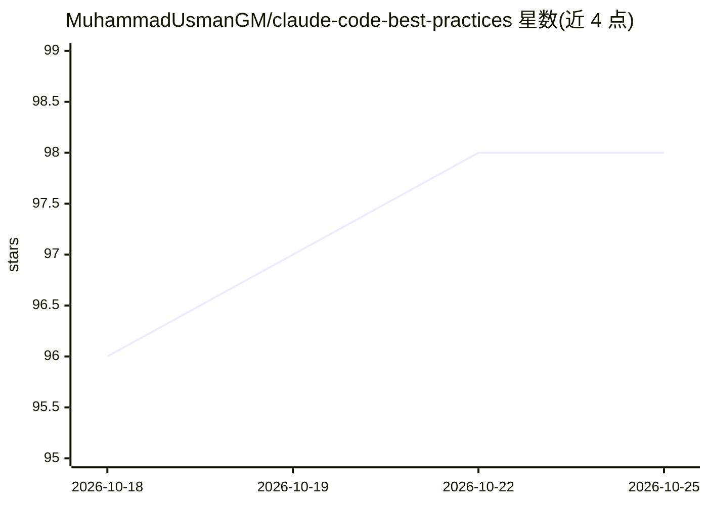

# MuhammadUsmanGM/claude-code-best-practices

⭐ 98 · Shell · MIT · 推送 2026-09-15 · [GitHub](https://github.com/MuhammadUsmanGM/claude-code-best-practices) · [官网](https://muhammadusmangm.github.io/claude-code-best-practices/) · 个人维护

**Claude Code 使用最佳实践知识库：指南、模板与启动套件**

社区维护的 Claude Code 最佳实践手册：收录 30+ 篇指南（基础、工作流、权限、成本、安全、企业模式）、11 个 CLAUDE.md 模板（React/Python/Go/Rust 等）、5 个整套启动套件（含 settings、skills、hooks）、可用的 commit-helper 等插件、drop-in 技能与 hook 脚本、带可复现 harness 的基准测试，以及安全手册（提示注入、插件供应链、团队审计清单）。面向首次配置 Claude Code 的个人开发者、做标准化的团队和插件/技能作者。知识本身以文档与可复制配置形式交付，使用前需自行安装 Claude Code CLI。

## 筛选速览

| 维度 | 判定 | 备注 |
|---|---|---|
| AI 角色 | `ai-knowledge` | 知识聚合/清单类 |
| 许可风险 | `permissive` | MIT |
| 部署形态 | `library` | 以包/库形式分发 |
| 模型依赖 | locked-api |  |
| 硬件要求 | — | 无带数字的原话,不猜 |
| 安装摩擦 | `low` | 无编译、无系统依赖或容器化 |
| 成熟度 | — | 结构信号不足 |

## 能力要点

- 30+ 指南覆盖工作流、权限、成本、安全与企业模式
- 11 个 CLAUDE.md 模板 + 5 个整套启动套件（含 hooks/skills）
- 可工作的 commit-helper 等插件与 block-secrets 等 hook 脚本
- 带可复现 harness 的基准测试与 100 分制 Setup Auditor 工具

## 适用场景

- 新项目按技术栈选一个启动套件快速接入 Claude Code
- 团队制定统一的 CLAUDE.md、权限策略与 onboarding 文档
- 插件/技能/hook 作者寻找参考实现

## 场景标签

`精选清单` `教程课程` · 领域:学习与行业

## 证据(README 行号)

> L24: - **30+ guides** covering fundamentals, workflows, permissions, advanced architecture, cost management, and securit
> L31: - **Dogfooded `.claude/` setup** you can copy — see `CLAUDE.md` and `.claude/`.

## 星数曲线

2026-10-18 96 → 2026-10-25 98（+2）

---
*卡片 v1 · prompt 1.4 · 生成 2026-10-23 · 置信度 mid · 依据 README sha `6baee2163b37` · [字段定义](../../DATASET.md)*
