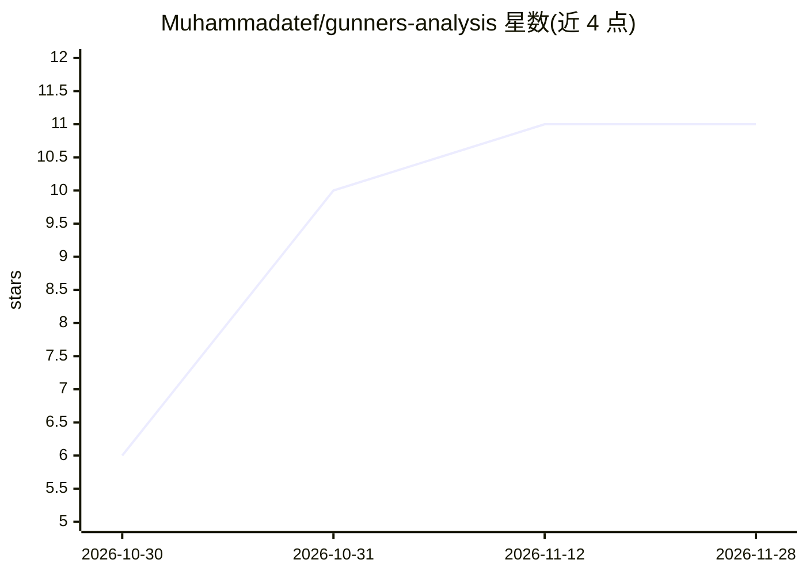

# Muhammadatef/gunners-analysis

⭐ 11 · Python · MIT · 推送 2026-10-29 · [GitHub](https://github.com/Muhammadatef/gunners-analysis) · 个人维护

**足球比赛数据管道+有证据约束的 AI 战术问答系统**

面向阿森纳比赛的全自动分析系统：赛后 30 分钟 Airflow DAG 抓取 Opta 事件流，合并 SofaScore 的 xG/xGOT，经数据契约校验后渲染 18 面战术看板并载入 PostgreSQL（pgvector 存语义文档）。仓库之上运行 DSPy+LiteLLM 构建的 AI 分析师：只从白名单查询中选 ID、算术交给沙盒计算器、答案中每个数字须与工具证据匹配，不匹配即计为幻觉，并可正确拒答。支持按需分析任意俱乐部（两个链接）、整季回填与流式问答 API。仅提供代码，不含抓取数据。

## 筛选速览

| 维度 | 判定 | 备注 |
|---|---|---|
| AI 角色 | `ai-native` | 本体是模型或模型工具 |
| 许可风险 | `permissive` | MIT |
| 部署形态 | `None` |  |
| 模型依赖 | locked-api |  |
| 硬件要求 | — | 无带数字的原话,不猜 |
| 安装摩擦 | `low` | 无编译、无系统依赖或容器化 |
| 成熟度 | — | 结构信号不足 |

## 能力要点

- AI 分析师：白名单查询+沙盒计算器+数字逐项校验证据
- 赛后 30 分钟自动触发的每场比赛一条 DAG 的整季编排
- 18 面战术看板与基于看板的 REPORT.md 报告
- YOLOv8 实验性比赛视频球员追踪模块

## 适用场景

- 赛后自动生成战术看板与书面报告
- 用自然语言提问并得到带证据引用的赛季数据回答
- 回填整季 38 场比赛建立俱乐部数据仓库

## 场景标签

`网页抓取` `数据分析` · 领域:效率与自动化

## 证据(README 行号)

> L5: Football data engineering, web scraping and AI in one open-source system.
> L14: into PostgreSQL. On top of the warehouse sits an AI analyst that answers questions in
> L121: On top of the warehouse sits an analyst that answers with cited evidence and is

## 星数曲线

2026-10-30 6 → 2026-11-28 11（+5）

---
*卡片 v1 · prompt 1.4 · 生成 2026-11-19 · 置信度 high · 依据 README sha `d08a22d1c3a4` · [字段定义](../../DATASET.md)*
