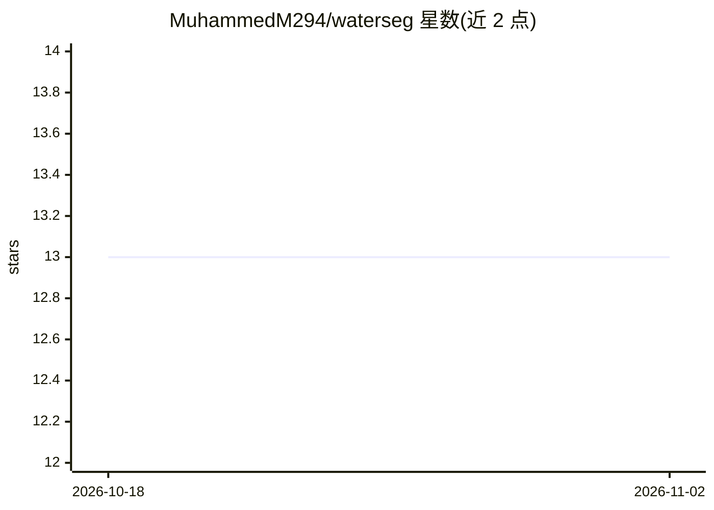

# MuhammedM294/waterseg

⭐ 13 · Python · MIT · 推送 2026-09-08 · [GitHub](https://github.com/MuhammedM294/waterseg) · 个人维护

**用 U-Net 从 Sentinel-1 SAR 影像分割埃及 Toushka 湖水体**

基于 PyTorch 与 U-Net 编码器-解码器架构的遥感水体分割项目：对埃及南部 Touskha 湖区 2019–2021 年 Sentinel-1 SAR 影像（90 张人工标注，70 训练/20 验证）做逐像素水体/非水体分类。项目在四种数据组合（VV 波段、RGB SAR 合成、VV+DEM、RGB+DEM）上训练并对比损失、像素精度、F1 与 IoU，RGB+DEM 组合指标最优。面向遥感与深度学习研究者，通过 git clone 与 pip 安装依赖运行。

## 筛选速览

| 维度 | 判定 | 备注 |
|---|---|---|
| AI 角色 | `ai-native` | 本体是模型或模型工具 |
| 许可风险 | `permissive` | MIT |
| 部署形态 | `library` | 以包/库形式分发 |
| 模型依赖 | — | README 未给出锁定关系 |
| 硬件要求 | — | 无带数字的原话,不猜 |
| 安装摩擦 | `low` | 无编译、无系统依赖或容器化 |
| 成熟度 | — | 结构信号不足 |

## 能力要点

- U-Net 编码器-解码器结构做 SAR 影像水体分割
- 对比四种数据组合（VV/RGB/VV+DEM/RGB+DEM）的训练指标
- 90 张人工标注 Sentinel-1 影像（70 训练/20 验证）
- RGB+DEM 组合在损失、精度、F1、IoU 上指标最优

## 适用场景

- 对 SAR 卫星影像做水体提取制图
- 研究极化信息与 DEM 地形特征对分割的影响
- 干旱区湖泊环境监测与水资源管理分析

## 场景标签

`目标检测` · 领域:感知与多模态

## 证据(README 行号)

> L5: The segmentation task is achieved using Sentinel-1 SAR imagery with the PyTorch framework and the U-Net architecture
> L10: The objective of this project is to develop a deep learning model that can accurately segment the water bodies of T

## 星数曲线

2026-10-18 13 → 2026-11-02 13（+0）

---
*卡片 v1 · prompt 1.4 · 生成 2026-10-31 · 置信度 mid · 依据 README sha `8fe01c808229` · [字段定义](../../DATASET.md)*
