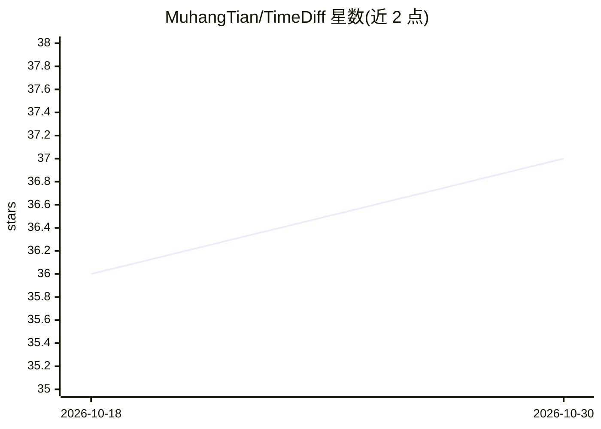

# MuhangTian/TimeDiff

⭐ 37 · Jupyter Notebook · 推送 2026-05-22 · [GitHub](https://github.com/MuhangTian/TimeDiff) · 组织维护

**用扩散模型生成隐私保护合成 EHR 时间序列的研究代码**

TimeDiff 论文（JAMIA 接收）的官方代码实现：训练扩散模型生成混合类型的 EHR 时间序列合成数据，用于隐私保护场景。提供训练脚本 etdiff_train.py（训练后自动生成合成数据）、数据预处理 notebook 与脚本（PostgreSQL 方言，支持 MIMIC-III/IV、eICU、HiRID 数据集）、8 个对比基线（EHR-M-GAN、TimeGAN 等）及数据效用与隐私风险评测脚本。面向科研用户，需自备受限访问的真实 EHR 数据。

## 筛选速览

| 维度 | 判定 | 备注 |
|---|---|---|
| AI 角色 | `ai-native` | 本体是模型或模型工具 |
| 许可风险 | `none` | — |
| 部署形态 | `None` |  |
| 模型依赖 | — | README 未给出锁定关系 |
| 硬件要求 | — | 无带数字的原话,不猜 |
| 安装摩擦 | `low` | 无编译、无系统依赖或容器化 |
| 成熟度 | — | 结构信号不足 |

## 能力要点

- 扩散模型生成混合类型 EHR 时间序列
- 训练完成后自动生成合成数据
- 包含数据效用与隐私风险两类评测指标
- 内置 8 个可运行对比基线

## 适用场景

- 生成合成 EHR 时序数据用于隐私保护的数据共享
- 复现论文实验或与基线模型对比
- 评测合成医疗数据的效用与隐私风险

## 场景标签

`科研工具` · 领域:学习与行业

## 证据(README 行号)

> L4: This repository contains the code implementation for TimeDiff, a diffusion model designed for the generation of mixe
> L8: * `etdiff_train.py` is the script to initialize model training. After training is complete, it will automatically ge

## 星数曲线

2026-10-18 36 → 2026-10-30 37（+1）

---
*卡片 v1 · prompt 1.4 · 生成 2026-10-25 · 置信度 high · 依据 README sha `b95fc1bdc9d8` · [字段定义](../../DATASET.md)*
