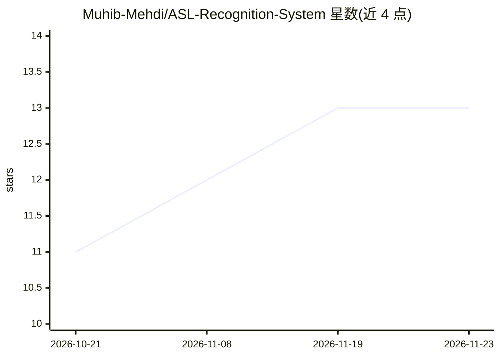

# Muhib-Mehdi/ASL-Recognition-System

⭐ 13 · Jupyter Notebook · MIT · 推送 2026-01-04 · [GitHub](https://github.com/Muhib-Mehdi/ASL-Recognition-System) · [官网](https://asl-recognition-web.vercel.app/) · 个人维护

**实时美国手语字母手势识别应用：摄像头手势转文本**

基于 MediaPipe 手部关键点检测与自训练 TensorFlow Lite 模型的 ASL 手势识别应用：从摄像头读取 21 个手部关键点，经轻量全连接网络分类为 26 个字母并实时显示标签。支持双手检测、FPS 统计、按键切换的采集/数据集模式导出关键点 CSV，附 Jupyter 训练流水线。声称无需 GPU、模型约 4.8MB，CPU 推理 <10ms。MIT 许可，面向教育、医疗、开发者与研究人员。

## 筛选速览

| 维度 | 判定 | 备注 |
|---|---|---|
| AI 角色 | `ai-native` | 本体是模型或模型工具 |
| 许可风险 | `permissive` | MIT |
| 部署形态 | `library` | 以包/库形式分发 |
| 模型依赖 | — | README 未给出锁定关系 |
| 硬件要求 | `cpu-ok` | |
| 安装摩擦 | `low` | 无编译、无系统依赖或容器化 |
| 成熟度 | — | 结构信号不足 |

## 能力要点

- 实时识别 26 个 ASL 字母，支持最多双手同时检测
- MediaPipe 21 关键点 + TFLite 模型（约 4.8MB），CPU 推理
- 内置采集/数据集模式，导出关键点 CSV 用于自定义训练
- 附 Jupyter 训练流水线与模块化架构

## 适用场景

- 教学中向学生演示 ASL 字母识别
- 开发者将手语识别集成到自己的应用
- 研究人员基于关键点数据训练自定义手势模型

## 场景标签

`目标检测` · 领域:感知与多模态

## 证据(README 行号)

> L22: The **ASL Recognition System** is a cutting-edge deep learning application that revolutionizes accessibility by ena
> L24: Built with state-of-the-art computer vision and machine learning techniques, this system leverages **MediaPipe** fo

## 星数曲线

2026-10-21 11 → 2026-11-23 13（+2）

---
*卡片 v1 · prompt 1.4 · 生成 2026-11-18 · 置信度 mid · 依据 README sha `8807ec3abca8` · [字段定义](../../DATASET.md)*
