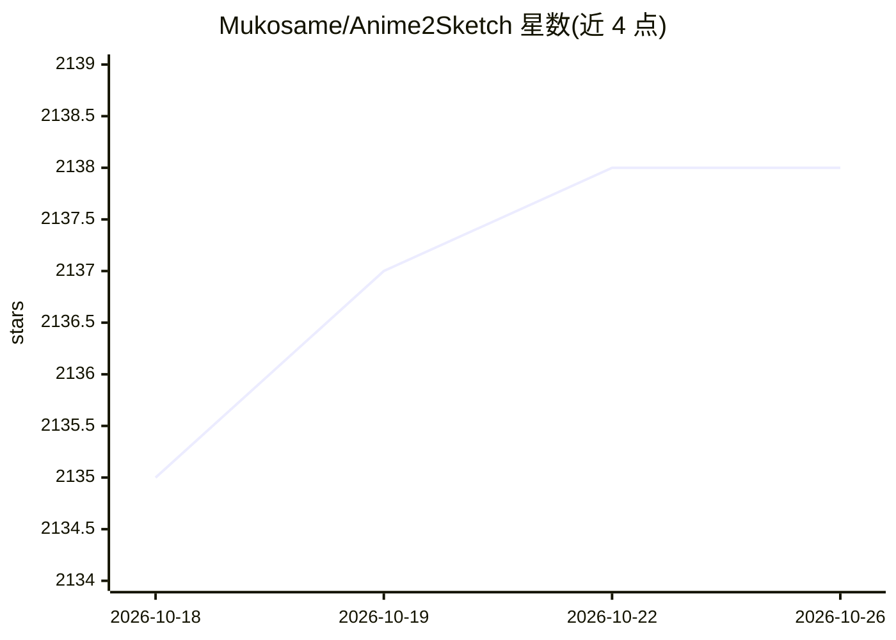

# Mukosame/Anime2Sketch

⭐ 2,138 · Python · MIT · 推送 2026-10-18 · [GitHub](https://github.com/Mukosame/Anime2Sketch) · 个人维护

**将插画/动漫/漫画图像提取为线稿的深度学习工具**

基于论文《Adversarial Open Domain Adaption for Sketch-To-Photo Synthesis》的草图提取器：提供测试代码与预训练权重，把插画、动漫、漫画图像转换为线稿，也可将手绘照片转为干净线稿、简化自由手绘草图。输入图像默认缩放至 512x512 以控制内存。运行于 Linux/macOS/Docker，支持 CPU 或 NVIDIA GPU（CUDA/CuDNN），另有适配暗色/低对比度图像的无伪影版本权重；训练需参考其上游项目 AODA。MIT 许可。

## 筛选速览

| 维度 | 判定 | 备注 |
|---|---|---|
| AI 角色 | `ai-native` | 本体是模型或模型工具 |
| 许可风险 | `permissive` | MIT |
| 部署形态 | `self-host` | docker 或自建部署 |
| 模型依赖 | — | README 未给出锁定关系 |
| 硬件要求 | `cpu-ok` | |
| 安装摩擦 | `low` | 无编译、无系统依赖或容器化 |
| 成熟度 | — | 结构信号不足 |

## 能力要点

- 提供预训练权重与 test.py 推理脚本
- 适用插画/动漫/漫画，含暗色图像适配的无伪影权重版本
- 支持 Docker 运行与 CPU-only 模式
- MIT 许可，附 Gradio Web Demo（社区贡献）

## 适用场景

- 把动漫插画转成线稿用于再创作
- 清理手绘照片得到干净的线条图
- 批量处理动漫视频帧提取线稿

## 场景标签

`图像视频处理` · 领域:感知与多模态

## 证据(README 行号)

> L2: *Anime2Sketch: A sketch extractor for illustration, anime art, manga*
> L22: Anime2Sketch is a sketch extractor that works well on illustration, anime art, and manga. It is an application base

## 星数曲线

2026-10-18 2,135 → 2026-10-26 2,138（+3）

---
*卡片 v1 · prompt 1.4 · 生成 2026-10-21 · 置信度 high · 依据 README sha `9a627eaba2ed` · [字段定义](../../DATASET.md)*
