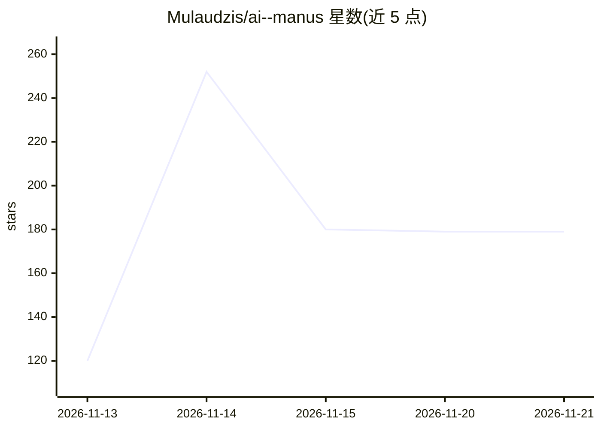

# Mulaudzis/ai--manus

⭐ 179 · Apache-2.0 · 推送 2026-11-14 · [GitHub](https://github.com/Mulaudzis/ai--manus) · 个人维护

**面向个人用户的自主 AI Agent：代跑代码与控制浏览器**

README 描述 Manus 为自主 AI 代理，可在用户授权下编写并执行脚本、打开网页、填写表单、跨脚本与浏览器执行多步任务，面向家庭、学习与轻量办公场景，强调小规模使用而非企业平台。给出最低/推荐硬件兼容表（双核 CPU、4GB RAM 起）与六步上手流程。README 仅含功能介绍与下载提示（PROMO2026），未提供安装命令、技术架构、代码或接入方式等可验证细节，无法确认实际实现与模型来源。

## 筛选速览

| 维度 | 判定 | 备注 |
|---|---|---|
| AI 角色 | `ai-native` | 本体是模型或模型工具 |
| 许可风险 | `permissive` | Apache-2.0 |
| 部署形态 | `None` |  |
| 模型依赖 | — | README 未给出锁定关系 |
| 硬件要求 | — | 无带数字的原话,不猜 |
| 安装摩擦 | `low` | 无编译、无系统依赖或容器化 |
| 成熟度 | — | 结构信号不足 |

## 能力要点

- 自主执行代码与浏览器控制相结合的多步任务
- 支持脚本与浏览器动作在同一任务流中衔接
- 面向非开发者的小规模日常任务场景

## 适用场景

- 让 agent 代为收集网页资料并整理摘要
- 自动执行重复性脚本与表单填写
- 学习或轻量办公中的小任务委派

## 场景标签

`浏览器自动化` `编码 Agent` · 领域:效率与自动化

## 证据(README 行号)

> L10: - **Autonomous Code Execution:** Manus AI agent runs code on its own to complete tasks, so you can focus on decisio
> L18: Manus is an autonomous AI agent designed to run code and control a browser on your behalf. Instead of acting like a

## 星数曲线

2026-11-13 120 → 2026-11-21 179（+59）

---
*卡片 v1 · prompt 1.4 · 生成 2026-11-17 · 置信度 low · 依据 README sha `dd9cc437df81` · [字段定义](../../DATASET.md)*
