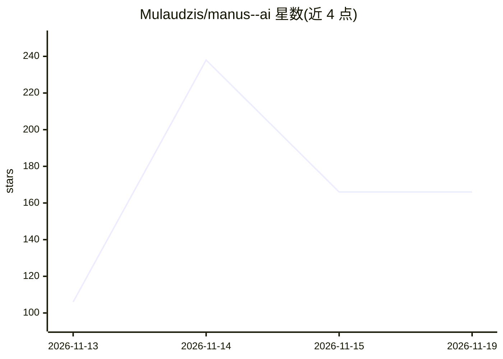

# Mulaudzis/manus--ai

⭐ 166 · Apache-2.0 · 推送 2026-11-14 · [GitHub](https://github.com/Mulaudzis/manus--ai) · 个人维护

**面向个人用户的自主 AI Agent：代跑代码与操控浏览器**

README 以宣传口径介绍 Manus：一个自主 AI agent，可在用户侧执行脚本、控制浏览器完成表单填写、网页信息收集等多步骤任务，定位为家庭、学习与轻量办公的个人助手，明确表示面向非开发者的小规模场景。描述其可在脚本与浏览器动作间衔接工作流并跨会话保持一致。README 未提供任何安装命令、技术架构、模型接入方式或代码仓库内容说明；给出 4GB RAM 起步的兼容性表。

## 筛选速览

| 维度 | 判定 | 备注 |
|---|---|---|
| AI 角色 | `ai-native` | 本体是模型或模型工具 |
| 许可风险 | `permissive` | Apache-2.0 |
| 部署形态 | `None` |  |
| 模型依赖 | — | README 未给出锁定关系 |
| 硬件要求 | — | 无带数字的原话,不猜 |
| 安装摩擦 | `low` | 无编译、无系统依赖或容器化 |
| 成熟度 | — | 结构信号不足 |

## 能力要点

- 自主执行代码与浏览器操控（导航、填表、信息收集）
- 支持脚本与浏览器动作衔接的多步骤任务
- 定位家庭/学习/轻量办公的非开发者用户

## 适用场景

- 让 agent 代为收集网页资料并整理笔记
- 自动完成重复性表单填写与文件检查
- 运行小脚本做快速实验与计算

## 场景标签

`浏览器自动化` `AI 助手` · 领域:效率与自动化

## 证据(README 行号)

> L10: - **Autonomous Code Execution:** Manus AI agent runs code on its own to complete tasks, so you can focus on decisio
> L18: Manus is an autonomous AI agent designed to run code and control a browser on your behalf. Instead of acting like a

## 星数曲线

2026-11-13 106 → 2026-11-19 166（+60）

---
*卡片 v1 · prompt 1.4 · 生成 2026-11-17 · 置信度 mid · 依据 README sha `dd9cc437df81` · [字段定义](../../DATASET.md)*
