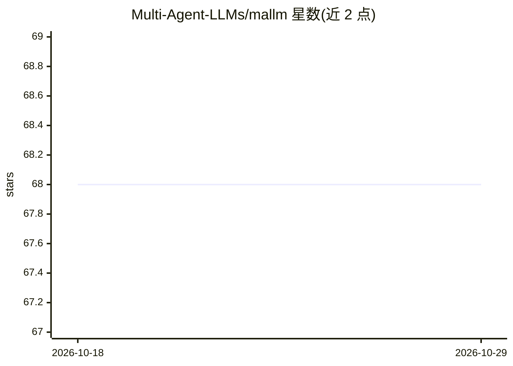

# Multi-Agent-LLMs/mallm

⭐ 68 · Python · Apache-2.0 · 推送 2026-10-10 · [GitHub](https://github.com/Multi-Agent-LLMs/mallm) · [官网](https://mallm.gipplab.org) · 组织维护

**多智能体 LLM 辩论实验框架：组合人格、讨论范式与决策协议跑实验**

EMNLP 2025 Demo 论文的 Python 框架，用于构建和运行多智能体 LLM 辩论：将人格生成器、响应生成器、讨论范式与决策协议组合为 144+ 种配置，通过外部 OpenAI 兼容端点（如 OpenAI API 或 Hugging Face TGI）运行讨论，并用脚本对输出 JSON 做 bleu/rouge/bertscore 等评估。框架分 agents、discourse_policy、decision_protocol 三部分，支持 CLI、模块导入与批量执行器。面向做 LLM 多智能体实验的研究者与开发者。

## 筛选速览

| 维度 | 判定 | 备注 |
|---|---|---|
| AI 角色 | `ai-ecosystem` | LLM/agent 周边工具 |
| 许可风险 | `permissive` | Apache-2.0 |
| 部署形态 | `library` | 以包/库形式分发 |
| 模型依赖 | — | README 未给出锁定关系 |
| 硬件要求 | — | 无带数字的原话,不猜 |
| 安装摩擦 | `low` | 无编译、无系统依赖或容器化 |
| 成熟度 | — | 结构信号不足 |

## 能力要点

- 人格/响应生成器/讨论范式/决策协议可组合为 144+ 种设置
- 5 种响应生成器、10 种决策协议、5 种讨论范式
- 通过 OpenAI 兼容端点运行（OpenAI API、Hugging Face TGI）
- 内置评估指标（bleu/rouge/bertscore/ifeval 等）与批量执行器

## 适用场景

- 在多数据集上批量运行多智能体辩论实验
- 比较不同决策协议与讨论范式对任务表现的影响
- 以 Python 包形式复用框架构建自己的实验

## 场景标签

`多智能体` `模型评测` · 领域:Agent 开发

## 证据(README 行号)

> L4:  Multi-Agent LLMs For Conversational Task-Solving: Framework
> L37: MALLM relies on an external API like OpenAI or Text Generation Inference by Huggingface.
> L197: *Jonas Becker, Lars Benedikt Kaesberg, Niklas Bauer, Jan Philip Wahle, Terry Ruas, and Bela Gipp. 2025. MALLM: Mul

## 星数曲线

2026-10-18 68 → 2026-10-29 68（+0）

---
*卡片 v1 · prompt 1.4 · 生成 2026-10-24 · 置信度 high · 依据 README sha `0507812de5ff` · [字段定义](../../DATASET.md)*
