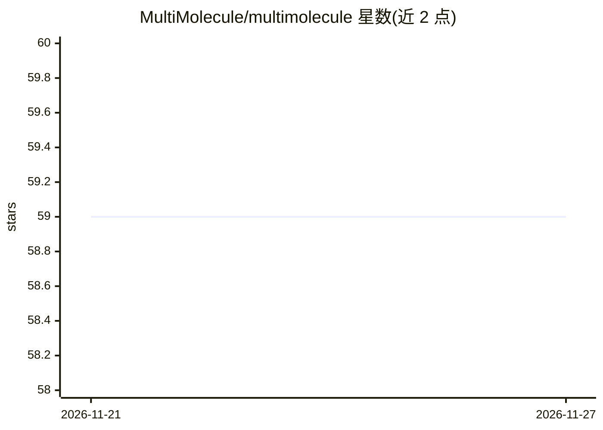

# MultiMolecule/multimolecule

⭐ 59 · Python · AGPL-3.0 · 推送 2026-11-21 · [GitHub](https://github.com/MultiMolecule/multimolecule) · [官网](https://multimolecule.danling.org/) · 组织维护

**分子机器学习一站式生态库：RNA/DNA/蛋白预测与训练**

面向分子机器学习的 Python 生态库，整合任务感知数据集、RNA/DNA/蛋白模型实现、分词器、FASTA/DBN/BPSEQ 等格式读写模块、基于 DanLing 的训练评测 runner 与面向任务的推理 pipeline。通过 import multimolecule 注册后可经 Hugging Face transformers 接口调用 pipeline 做二级结构预测等任务，也可用 AutoModel/AutoTokenizer 直接加载模型。以 PyPI 包分发，许可证为 AGPL v3。

## 筛选速览

| 维度 | 判定 | 备注 |
|---|---|---|
| AI 角色 | `ai-native` | 本体是模型或模型工具 |
| 许可风险 | `viral` | AGPL-3.0 |
| 部署形态 | `library` | 以包/库形式分发 |
| 模型依赖 | — | README 未给出锁定关系 |
| 硬件要求 | — | 无带数字的原话,不猜 |
| 安装摩擦 | `low` | 无编译、无系统依赖或容器化 |
| 成熟度 | — | 结构信号不足 |

## 能力要点

- 注册后经 transformers pipeline 接口运行 RNA/DNA/蛋白推理任务
- 提供 FASTA、DBN、BPSEQ、bpRNA ST 格式的读取与写入
- 包含任务感知数据集、多任务采样与可复用神经网络模块
- 模型归因解释模块（token 级分数）

## 适用场景

- 对 RNA/DNA/蛋白序列做二级结构或性质预测
- 训练与评测分子序列模型
- 解析与写出生物分子序列格式文件

## 场景标签

`模型评测` `科研工具` · 领域:评测与运维

## 证据(README 行号)

> L18: MultiMolecule is a one-stop ecosystem for molecular machine learning.
> L35: predictor = pipeline("rna-secondary-structure", model="multimolecule/ernierna-ss")

## 星数曲线

2026-11-21 59 → 2026-11-27 59（+0）

---
*卡片 v1 · prompt 1.4 · 生成 2026-11-22 · 置信度 high · 依据 README sha `dfee9e0fd0db` · [字段定义](../../DATASET.md)*
