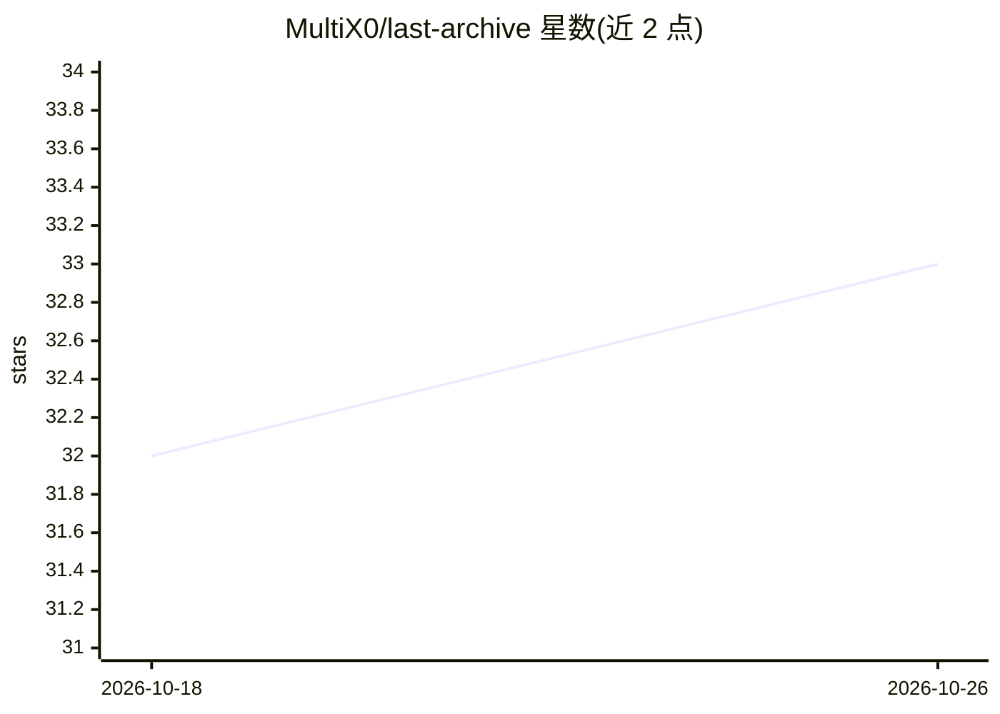

# MultiX0/last-archive

⭐ 33 · Go · MIT · 推送 2026-01-31 · [GitHub](https://github.com/MultiX0/last-archive) · 个人维护

**本地优先的网页存档与语义搜索 RAG 引擎，完全离线运行**

面向个人知识保存与检索的自托管系统：内置 Go 高并发爬虫抓取网页（HTML/图片/PDF），Python 嵌入服务生成向量，Qdrant 做语义检索，通过 Ollama 桥接提供 LLM 问答，前端为 Next.js 界面。各组件以 Docker 微服务运行，依赖提供的 archive.sh/archive.ps1 脚本创建内部网络并启动，不支持手动 docker-compose 启动。回答完全基于已爬取的数据库内容，数据量不足时回答受限。MIT 许可，仅供教育与个人存档用途。

## 筛选速览

| 维度 | 判定 | 备注 |
|---|---|---|
| AI 角色 | `ai-native` | 本体是模型或模型工具 |
| 许可风险 | `permissive` | MIT |
| 部署形态 | `self-host` | docker 或自建部署 |
| 模型依赖 | local-ok | 支持本地模型 |
| 硬件要求 | — | 无带数字的原话,不猜 |
| 安装摩擦 | `low` | 无编译、无系统依赖或容器化 |
| 成熟度 | — | 结构信号不足 |

## 能力要点

- 爬取-嵌入-检索-问答全链路本地运行，无外部 API 依赖
- Go 爬虫支持 HTML/图片/PDF 存档，遵守 robots.txt
- SQLite 关系元数据与 Qdrant 向量混合存储
- 微服务架构经 Docker Compose 网络编排

## 适用场景

- 把常用网站离线存档，本地搭建私人知识库问答
- 对个人存档内容做语义检索与 LLM 对话
- 数据不出本地的隐私优先网页采集

## 场景标签

`网页抓取` `文档问答` `语义搜索` · 领域:效率与自动化

## 证据(README 行号)

> L7:  A high-performance, local-first search and archival engine powered by RAG.
> L21: * **Privacy-First RAG**: Context-aware intelligence using your personal archives without external API dependencies.
> L33: * **Llama-Go (Go)**: A high-performance bridge for Ollama, providing OpenAI-compatible LLM inference endpoints.

## 星数曲线

2026-10-18 32 → 2026-10-26 33（+1）

---
*卡片 v1 · prompt 1.4 · 生成 2026-10-26 · 置信度 high · 依据 README sha `d7a75ee5db89` · [字段定义](../../DATASET.md)*
