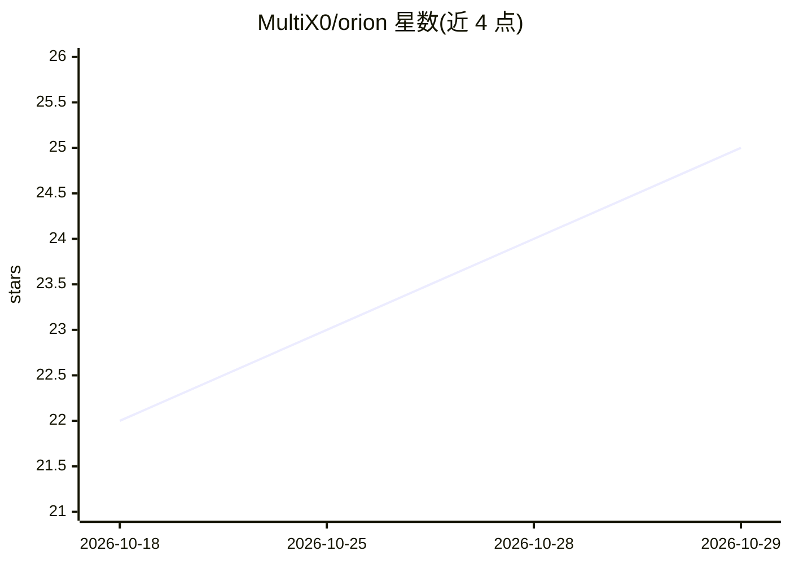

# MultiX0/orion

⭐ 25 · C · NOASSERTION · 推送 2026-10-21 · [GitHub](https://github.com/MultiX0/orion) · [官网](https://joinorion.io/) · 个人维护

**自组桌面语音助手套件：ESP32-S3 板 + 双语唤醒应答**

面向消费者的桌面语音助手项目：用户购买 LilyGO T-CameraPlus-S3 开发板，用一键脚本（Windows 批处理或 curl 命令）刷入固件，再通过 Android/Windows 的 Flutter 应用经蓝牙配网并填入 API key。唤醒词在板上用 TensorFlow Lite Micro 运行，语音出入走 Fish Audio，回答模型支持任意 OpenAI 兼容服务（DeepInfra 默认）。支持阿拉伯语与英语问答、摄像头识物、PC 控制与对话记忆。许可证为 PolyForm Noncommercial，仅限非商业使用；需自购硬件并自备各家服务 key。

## 筛选速览

| 维度 | 判定 | 备注 |
|---|---|---|
| AI 角色 | `ai-native` | 本体是模型或模型工具 |
| 许可风险 | `none` | NOASSERTION |
| 部署形态 | `desktop` | 安装包/桌面程序 |
| 模型依赖 | local-ok | 支持本地模型 |
| 硬件要求 | — | 无带数字的原话,不猜 |
| 安装摩擦 | `low` | 无编译、无系统依赖或容器化 |
| 成熟度 | — | 结构信号不足 |

## 能力要点

- 唤醒词在板上离线运行（TensorFlow Lite Micro），唤醒前音频不出家门
- 支持任意 OpenAI 兼容模型：DeepInfra/OpenAI/Anthropic/Groq/OpenRouter/本地 Ollama
- 配套 Flutter 应用（Android/Windows）做蓝牙配网、对话、摄像头直播与 Windows PC 控制（三档信任级别、动作留痕）
- 附带 3D 打印外壳设计（STL/3MF/Blender 源文件）与一键刷机脚本

## 适用场景

- 在书桌上放一个自己组装、自备 API key 的语音助手
- 用阿拉伯语或英语语音提问、让它看摄像头描述眼前事物
- 让助手代为操作 Windows PC：开关应用、控制媒体、查系统状态

## 场景标签

`语音 Agent` · 领域:对话与助手

## 证据(README 行号)

> L42: Orion is a voice assistant that lives on a small board with a screen, a camera, a microphone and a speaker. It list
> L63: - Works with any OpenAI-compatible model: DeepInfra, OpenAI, Anthropic, Groq, OpenRouter, Ollama on your own networ

## 星数曲线

2026-10-18 22 → 2026-10-29 25（+3）

---
*卡片 v1 · prompt 1.4 · 生成 2026-10-27 · 置信度 high · 依据 README sha `991122ad69a6` · [字段定义](../../DATASET.md)*
