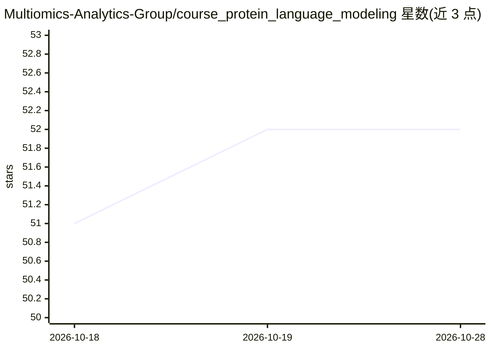

# Multiomics-Analytics-Group/course_protein_language_modeling

⭐ 52 · Jupyter Notebook · Apache-2.0 · 推送 2026-08-20 · [GitHub](https://github.com/Multiomics-Analytics-Group/course_protein_language_modeling) · 组织维护

**蛋白质语言建模课程：理论讲义与 Colab 实践笔记本**

面向蛋白质语言模型学习者的课程仓库：理论部分提供主题讲义，实践部分含 6 个可在 Google Colab 打开的 Jupyter 笔记本，覆盖序列分析、模型微调（ESM）、嵌入提取（ProTrans）、性质预测、蛋白质设计（ProtGPT2/ESM）与机制可解释性（在 ESM2 上训练稀疏自编码器）。本地运行通过 Docker Compose 启动 JupyterLab（8888 端口），并附 VM 部署步骤。另收录 49 篇参考文献与外部资源清单。

## 筛选速览

| 维度 | 判定 | 备注 |
|---|---|---|
| AI 角色 | `ai-knowledge` | 知识聚合/清单类 |
| 许可风险 | `permissive` | Apache-2.0 |
| 部署形态 | `self-host` | docker 或自建部署 |
| 模型依赖 | — | README 未给出锁定关系 |
| 硬件要求 | — | 无带数字的原话,不猜 |
| 安装摩擦 | `low` | 无编译、无系统依赖或容器化 |
| 成熟度 | — | 结构信号不足 |

## 能力要点

- 6 个 Colab 笔记本覆盖序列分析、微调、嵌入、预测、设计与可解释性
- 本地/VM 均通过 docker compose 启动 JupyterLab
- 49 篇蛋白质语言模型相关参考文献
- 模型涉及 ESM/ESM2、ProTrans、ProtGPT2 等

## 适用场景

- 系统学习蛋白质语言模型的理论与实践
- 在 Colab 上动手微调模型与提取蛋白质嵌入
- 查找蛋白质语言模型领域的论文与资源入口

## 场景标签

`教程课程` · 领域:学习与行业

## 证据(README 行号)

> L10: ## Course Structure
> L16: ||**Sequence Analysis**|Seq. Analysis Notebook Open In Colab|Exploring protein sequence and structure data||

## 星数曲线

2026-10-18 51 → 2026-10-28 52（+1）

---
*卡片 v1 · prompt 1.4 · 生成 2026-10-24 · 置信度 high · 依据 README sha `b00d187a5a5b` · [字段定义](../../DATASET.md)*
