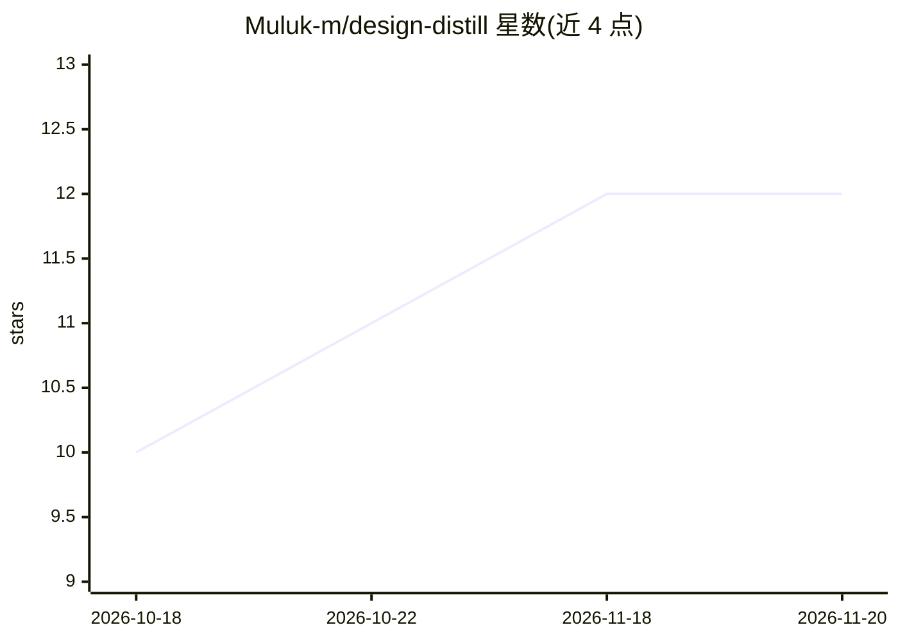

# Muluk-m/design-distill

⭐ 12 · JavaScript · MIT · 推送 2026-06-14 · [GitHub](https://github.com/Muluk-m/design-distill) · 个人维护 · 中文 README

**把任意网站设计系统提炼成可复用 DESIGN.md 的 agent 技能**

以 AI agent 技能（skill）形式提供的工具：从线上网站或本地项目提取设计 token（颜色、字体、间距、组件），经 dembrandt 与截图校准，输出符合 Google Stitch 规范的 DESIGN.md，写入本地设计库（tokens.json 为规范格式）；配套 design-apply 技能在生成代码时约束到该设计系统。无全局 CLI，自带零构建 .mjs 脚本，复用系统已有浏览器（Chrome/Edge 或 CDP 端点），仅在缺失时下载 Chromium。内置 GitHub、Linear、Notion、Stripe、Vercel 5 个设计系统。

## 筛选速览

| 维度 | 判定 | 备注 |
|---|---|---|
| AI 角色 | `ai-native` | 本体是模型或模型工具 |
| 许可风险 | `permissive` | MIT |
| 部署形态 | `library` | 以包/库形式分发 |
| 模型依赖 | — | README 未给出锁定关系 |
| 硬件要求 | — | 无带数字的原话,不猜 |
| 安装摩擦 | `low` | 无编译、无系统依赖或容器化 |
| 成熟度 | — | 结构信号不足 |

## 能力要点

- 从 URL 或本地项目提取设计 token 并输出 Stitch 兼容的 DESIGN.md
- design-apply 生成代码时严格约束到原站配色、字体与组件模式
- 纯文件设计库（tokens.json/DESIGN.md），可用 ls/cat/rm 直接管理
- 复用系统浏览器或 CDP 端点，无全局 CLI、无构建步骤

## 适用场景

- 让 AI agent 生成与目标网站风格一致的页面代码
- 把现有站点的设计规范整理成结构化文档供团队复用
- 为多个项目建立统一的设计 token 库

## 场景标签

`代码生成` · 领域:编码与开发

## 证据(README 行号)

> L49: Extracts design tokens via dembrandt + screenshots for visual ground truth. Outputs a Stitch-compatible `DESIGN.md`
> L58: Loads a design system, re-screenshots the source site for visual calibration, generates code strictly constrained t
> L105: Works with **Claude Code**, **Codex**, **Openclaw**, and any agent that supports skills.

## 星数曲线

2026-10-18 10 → 2026-11-20 12（+2）

---
*卡片 v1 · prompt 1.4 · 生成 2026-11-18 · 置信度 mid · 依据 README sha `2c1a4078f69e` · [字段定义](../../DATASET.md)*
