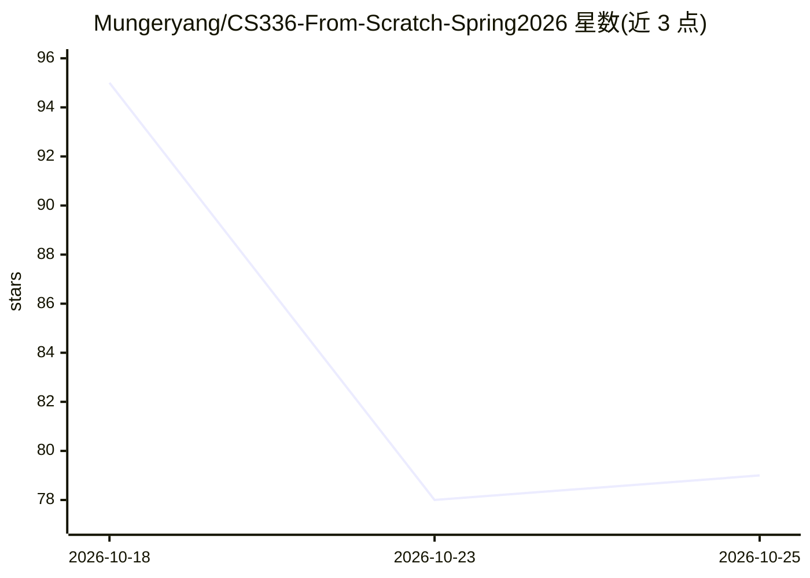

# Mungeryang/CS336-From-Scratch-Spring2026

⭐ 79 · Jupyter Notebook · 推送 2026-09-20 · [GitHub](https://github.com/Mungeryang/CS336-From-Scratch-Spring2026) · 个人维护 · 中文 README

**斯坦福 CS336 课程的中文学习笔记与从零实现作业合集**

中国科学院大学硕士生整理的 CS336（Language Modeling from Scratch）Spring 2026 学习仓库：包含课堂笔记、五个作业（BPE 分词器、Transformer 组件、AdamW、FlashAttention2 的 Triton 实现、分布式训练、Scaling Law、数据清洗去重、SFT/RL 对齐）的实现与结果、大模型面试 50 问中文整理，以及 LoRA/DPO 微调实验计划（HandonLLM 部分）。问题与作答全部开源，欢迎 fork 更新。

## 筛选速览

| 维度 | 判定 | 备注 |
|---|---|---|
| AI 角色 | `ai-knowledge` | 知识聚合/清单类 |
| 许可风险 | `none` | — |
| 部署形态 | `None` |  |
| 模型依赖 | — | README 未给出锁定关系 |
| 硬件要求 | — | 无带数字的原话,不猜 |
| 安装摩擦 | `low` | 无编译、无系统依赖或容器化 |
| 成熟度 | — | 结构信号不足 |

## 能力要点

- Assignment 1 覆盖 tokenizer/Transformer 组件/AdamW 等从零实现
- Assignment 2 含自实现 Triton 版 FlashAttention2 与分布式训练
- 整理大模型面试 50 问中文问答
- HandonLLM 部分计划 LoRA-SFT 与 DPO 微调实验

## 适用场景

- 跟学 CS336 课程时对照参考实现与笔记
- 准备大模型算法面试的中文问答复习
- 了解从零训练 Transformer LM 的完整作业路线

## 场景标签

`教程课程` · 领域:学习与行业

## 证据(README 行号)

> L3: > The NoteBook and Assignments implemention via Learning CS336 Spring 2026！
> L17: > ### 通过整理 `Standford CS336 Spring26` 课堂笔记，总结大模型算法经典面试**50**问

## 星数曲线

2026-10-18 95 → 2026-10-25 79（-16）

---
*卡片 v1 · prompt 1.4 · 生成 2026-10-24 · 置信度 high · 依据 README sha `13013b91a5dd` · [字段定义](../../DATASET.md)*
